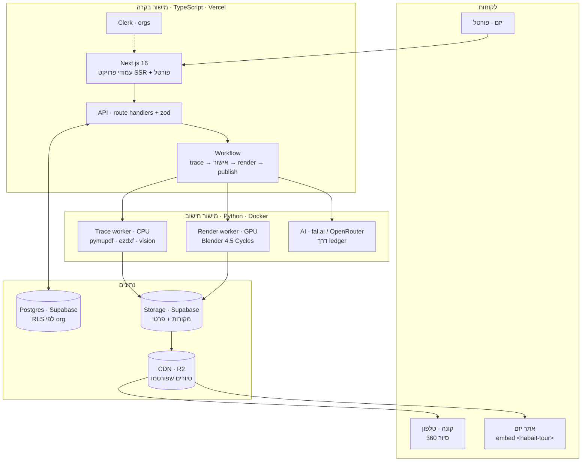

# סטאק וארכיטקטורה לפרויקט הדמיות — המלצה מנומקת
<!-- 2026-11-08 · main session · research plan: 2026-11-08-visualization-stack-research.md -->

**למי:** אלירן (ראש R&D), וכל מפתח שיצטרף.
**מה זה:** תוצאת המחקר על הסטאק והארכיטקטורה הנכונים למוצר הדמיות כמו Habait, כולל מסלול מעבר מהקוד הקיים.
**עמוד לקריאה:** https://claude.ai/artifact/6mZtm2ofVc91JKTQCkb4Wt
**עדכון אלירן (2026-11-08):**
- **מאפס:** ארכיטקטורה מאפס, לפי מטרת הפרויקט, בלי אילוץ של הקוד הקיים ("אני רוצה ארכיטקטורה מאפס").
- **היקף יעד:** 10–100 פרויקטים בחודש.
- **בלי חשש מתלות:** התלות ב-Vercel וגודל הצוות לא רלוונטיים כרגע.

**ההשלכות:**
- **מסלול המעבר (§6) הוא רק הפניה.** סדר הבנייה מאפס:
  1. חוזים ומסד נתונים
  2. container ב-Python לקריאת PDF ול-Blender (הלוגיקה של הקוד הקיים עוברת כידע)
  3. Next.js: פורטל העלאה ואישור + Workflow
  4. רכיב הסיור על PSV + אריחים
  5. עמודי הקונה

  נגישות, אנליטיקס וניטור נבנים לאורך כל הדרך.
- **Vercel Workflow** נשאר הבחירה, ו-Trigger.dev כבר לא נחוץ כגיבוי לתלות.
- **ההחלטות** בטבלה (§1) לא משתנות.

**מה זה לא:** החלטה. כל בחירה בספק בתשלום וכל מעבר בפועל מחכים להחלטה של אלירן ול-board נפרד (§6, §7).

**איך נאסף:** מיפוי הקוד הקיים (Explore, 2026-11-08) ושני סוכני מחקר רשת, אחד ל-frontend ול-viewer ואחד ל-backend, compute ותשתית. החיפוש היה בעיקר על snippets, כי חלק מדפי npm ו-GitHub החזירו 403 ו-504. מחיר או גרסה שלא אומתו מול מקור רשמי מסומנים **(לא מאומת)**. מקורות בסוף המסמך.

---

## 0. התשובה הקצרה: מה בחרתי

**לא framework אחד לכל המערכת, וגם לא frontend ו-backend קלאסיים.** הבחירה היא **Next.js כ-framework מלא** (frontend ו-backend של האתר, באותו קוד ובאותה שפה), ולצידו **backend נפרד ב-Python** רק לחישוב הכבד.

| חלק | הבחירה | למה |
|---|---|---|
| **Frontend** | **Next.js + React + TypeScript**; עיצוב ב-Tailwind + shadcn/ui (RTL); הסיור כרכיב עצמאי (PSV + three.js) | עמודים לקונה עם תצוגה מקדימה כששולחים קישור, ופורטל ליזם, בקוד אחד. ל-React יש את הכלים הכי טובים לתלת-ממד |
| **Backend של האתר** | **בתוך Next.js, ב-TypeScript** (API routes + zod, ‏Clerk, ‏Postgres ב-Supabase) | משתמשים, פרויקטים, הרשאות וסטטוס עבודות. אותה שפה כמו ה-frontend, ואין צורך בשרת נפרד |
| **Backend של החישוב** | **Python בקונטיינר על GPU** (Blender 4.5, ‏pymupdf, ‏ezdxf, ‏RunPod/Modal) | Blender וקריאת ה-PDF עובדים רק ב-Python. אלה עבודות של 10–40 דקות, לא שרת שעונה לבקשות |

| האפשרות | הבחירה | למה |
|---|---|---|
| Framework אחד לכל המערכת | לא | Blender מחייב Python |
| Frontend ו-backend נפרדים (React + שרת Node או FastAPI) | לא | שני שרתים ושני deploys בשביל מה ש-Next.js עושה בפרויקט אחד |
| Angular | לא | פחות כלים לתלת-ממד, ופחות מפתחים זמינים בישראל |
| JS/HTML/CSS נקי (המצב היום) | רק לסיור 360 | לא מחזיק פורטל עם משתמשים והרשאות |
| **Next.js + worker ב-Python** | **כן** | שפה אחת לכל האתר, ו-Python רק במקום שאין לו תחליף |

## 1. השורה התחתונה

הארכיטקטורה מחולקת לשני מישורים. כל אחד כתוב בשפה שמתאימה לו, וחוזה מוקלד אחד מחבר ביניהם.

- **מישור הבקרה (Control plane):** מה שהמשתמש רואה, וכל ניהול העבודה. כתוב ב-**TypeScript**: Next.js על Vercel, Clerk ו-Postgres.
- **מישור החישוב (Compute plane):** כל מה שכבד ודטרמיניסטי: קריאת התוכנית, בניית הסצנה, הרינדור וה-AI. כתוב ב-**Python** ורץ כ-workers בקונטיינר, על GPU לפי דרישה.

| שכבה | הבחירה | למה, במשפט אחד |
|---|---|---|
| ארכיטקטורה | שני מישורים: monolith מודולרי ל-web ו-workers ל-compute. בלי microservices | צוות קטן. מספיק גבול אחד ברור, בין web לבין חישוב כבד |
| Framework לאפליקציה | **Next.js 16 (App Router) + React + TypeScript** | SSR ותצוגה מקדימה בשיתוף לעמודי פרויקט, פורטל עם auth וטפסים, האקוסיסטם הכי גדול ל-3D ול-AI agents, ו-Vercel כבר בשימוש |
| Viewer 360 | **Web Component עצמאי `<habait-tour>`** מעל Photo Sphere Viewer 5 + three.js | אותו רכיב רץ ב-Next.js, באתר של יזם (embed) ובקובץ סטטי |
| עיצוב | **Tailwind v4 + shadcn/ui במצב RTL** לפורטל. ה-viewer נשאר על CSS tokens | ל-shadcn יש RTL רשמי מינואר 2026. ה-viewer לא תלוי ב-framework |
| Backend לאפליקציה | **TypeScript** (route handlers / server actions + zod) | אותה שפה כמו ה-frontend, וטיפוסים משותפים |
| Backend לחישוב | **Python 3.12 + uv**, כ-CLI בתוך Docker | ‏bpy של Blender, ‏pymupdf, ‏ezdxf ו-OpenCV קיימים בפועל רק ב-Python |
| החוזה בין המישורים | **JSON Schema כמקור אמת**, ומשם codegen ל-zod ול-pydantic | `plan.json` ו-`job.v1` כבר קיימים. הופכים אותם לחוזה שנבדק |
| תזמור jobs | עכשיו: נשאר JSON jobs. אחר כך: **Vercel Workflow** (גיבוי: Trigger.dev) | צריך עצירה לאישור אנושי, retries ו-idempotency. אין תקרת משך ריצה |
| רינדור GPU | **RunPod serverless** (או Modal) עם image של Blender 4.5 | ‏Vercel Sandbox בלי GPU (לא מאומת מול ה-changelog), והמחשב המקומי CPU בלבד |
| מסד נתונים | **Supabase Postgres + RLS לפי Clerk org** | כבר משתמשים ב-Supabase Storage. Clerk נתמך שם כ-third-party auth |
| אחסון assets | **Supabase Storage** עכשיו. **Cloudflare R2** לסיורים שפורסמו כשה-egress יגדל | מפתחות לפי content hash עם cache קבוע. ב-R2 אין עלות egress (לא מאומת) |
| התחברות | **Clerk Organizations** | כבר בשימוש. יזם = org (multi-tenant) |
| Hosting | **Vercel Pro לפני הלקוח המשלם הראשון** | ‏Hobby מותר לשימוש לא מסחרי בלבד (תיעוד Vercel, 2026-09-14) |
| Repo | **pnpm + Turborepo** ל-TS, **uv workspace** ל-Python, באותו ריפו | גבולות ברורים, גרסה אחת של three, ו-codegen כמשימת build |

---

## 2. דיאגרמת הארכיטקטורה

**הזרימה:**
1. היזם מעלה PDF.
2. ה-API רושם `source_file` ו-`job`.
3. ה-Workflow מפעיל את ה-trace worker.
4. ה-Workflow עוצר ומחכה לאישור של היזם.
5. מופעל ה-render worker על GPU.
6. AI restyle עם fidelity gate.
7. נבנית חבילת סיור: אריחים, `scenes.json` ו-manifest.
8. הסיור עולה ל-CDN תחת מפתח hash, והקונה רואה אותו.

כל צעד כותב artifact ושורת manifest לפני שהוא מדווח שסיים (§2). צעד בתשלום בודק את ה-manifest לפני שהוא רץ (§5, §7).

---

## 3. כל שכבה: האפשרויות, הבחירה, למה ומה ויתרנו

### 3.1 Framework לאפליקציה: Next.js 16
- **האפשרויות שנבדקו:** Next.js 16, Angular 22, React SPA (Vite), Vanilla / Web Components, Astro, SvelteKit, Nuxt.
- **למה Next.js:**
  - **שני קהלים בקוד אחד.** עמודי פרויקט ציבוריים לקונה צריכים SSR, `generateMetadata` ותצוגה מקדימה כששולחים קישור בוואטסאפ. הפורטל ליזם הוא אפליקציה, עם auth, טפסים, רשימות jobs ו-state. Next.js עושה את שניהם.
  - **Vercel ו-Clerk:** שניהם כבר בשימוש, ול-Clerk יש תמיכה מלאה ב-Next.js (`proxy.ts`).
  - **אקוסיסטם 3D:** ‏React Three Fiber ו-drei הם האקוסיסטם הגדול ביותר ל-three.js. ל-Angular אין מקבילה בגודל דומה.
  - **פיתוח עם סוכני AI:** הכמות הגדולה ביותר של קוד אימון היא React/Next, אז הסיכוי לקוד נכון בניסיון הראשון גבוה יותר (לא מאומת, אבל מקובל).
  - **גיוס:** בעולם React בכ-54% מהמשרות ו-Angular בכ-36% (devjobsscanner, נתון עולמי). בישראל יש טענה ל-67% מול 23%, בלי שיטה מוצהרת **(לא מאומת)**. Angular חזק בארגונים ובחברות סייבר.
- **מה ויתרנו:**
  - churn של ה-framework (‏middleware → proxy, שינויי caching).
  - צימוד ל-Vercel. מקטינים אותו בעזרת Postgres ו-Workflow Worlds, שיכולים לרוץ גם מחוץ ל-Vercel.
- **למה לא האחרות:**
  - **Angular:** טוב לארגונים, אבל אקוסיסטם ה-3D קטן ממנו, והוא כבד יותר למוצר של מפתח יחיד.
  - **React SPA:** בלי SSR אין תצוגה מקדימה כששולחים עמוד פרויקט.
  - **Vanilla (המצב היום):** מצוין ל-viewer, אבל לא מחזיק פורטל רב-משתמשים עם הרשאות.
  - **Astro:** מתאים לעמודים הציבוריים בלבד, וידרוש framework שני לפורטל.
- **מה נשאר כמו שהוא:** ה-viewer עצמו. לא כותבים אותו מחדש ב-React.

### 3.2 Viewer: Web Component עצמאי
- **האפשרויות:** Photo Sphere Viewer (PSV), Pannellum, Marzipano, three.js נקי, R3F, Babylon.js.
- **הבחירה:** **PSV 5** עם הפלאגינים virtual-tour, markers, cubemap ו-gyroscope, עטוף כ-`<habait-tour>`.
- **למה PSV:**
  - מתוחזק באופן פעיל.
  - בנוי על three.js, כמו שאר הקוד.
  - יש בו מערכת transitions (`transitionOptions`) ו-gyroscope.
  - הוא class רגיל בלי תלות ב-framework, אז עטיפה ב-custom element פשוטה.
  - כבר קיים אצלנו: build ה-`--engine` משתמש ב-PSV 5.15.1 (`tour360/engine/package.json`).
- **Pannellum:** קיבל את 2.5.7 ב-2026-02-18 עם תיקוני XSS ב-hotspots, כלומר רק תחזוקת אבטחה. אנחנו על 2.5.6 inlined. **לעדכן ל-2.5.7 כבר עכשיו.**
- **Marzipano:** פעילות נמוכה (לא מאומת). לא בונים עליו.
- **R3F:** נכון לבית הבובות ולתצוגת חוץ בתוך Next.js. לא הכלי הנכון לסיור cubemap.
- **מה ויתרנו:** PSV כבד מ-Pannellum (לא נמדד), ו-multires cubemap בו מוכח פחות. בודקים על טלפון אמיתי לפני מעבר.
- **Gaussian Splatting** (‏Spark 2.4, ‏SPZ v4, ‏LoD streaming):
  - מתבגר, אבל splat הוא מציאות מצולמת, לא גיאומטריה מתוכנית המכר. זה מתנגש בכלל add-only ובחובת הגילוי (§6).
  - בעלות Spark עוברת ל-AMD.
  - **ניסוי לחוץ בלבד. לא בונים עליו את המוצר.**

### 3.3 משלוח פנורמות
- **בהמשך:**
  - אריחי cubemap multires (512px, ‏3–4 רמות) ב-AVIF עם WebP כגיבוי.
  - קודם פנים בהפרדה נמוכה, אחר כך אריחים לפי מה שבשדה הראייה.
  - **(לא מאומת, למדוד על הרינדורים שלנו).**
- **מפתח:** `tours/<hash>/…` עם `Cache-Control: immutable`. זה תואם את כלל ה-content hash ב-manifest.
- **KTX2/Basis:** רק אם עוברים ל-WebGL נקי. אין בו תועלת ל-PSV/Pannellum.

### 3.4 עיצוב: Tailwind v4 + shadcn/ui (RTL)
- **הפורטל:** ל-shadcn יש תמיכת RTL מינואר 2026. מוסיפים `"rtl": true` ב-`components.json`, וה-CLI ממיר `ml-*` ל-`ms-*`.
  - ה-migration לא idempotent. מריצים פעם אחת ועושים commit מיד.
- **ה-viewer:** נשאר על CSS custom properties (‏`platform/css/tokens.css` קיים), כדי שה-embed לא יגרור Tailwind.
- **מלכודות RTL:**
  - ה-canvas של הסיור נשאר LTR, ורק ה-chrome מתהפך.
  - מספרים, ₪ וטלפונים עוטפים ב-`bdi`. סקיל `hebrew-rtl-best-practices` מכסה את זה.
- **מה ויתרנו:** בלי עבודה על tokens הפורטל ייראה כמו shadcn דיפולטי. ב-popover ובסליידרים של Radix ב-RTL ייתכנו תיקונים ידניים (לא מאומת).

### 3.5 Backend: שתי שפות, בכוונה
- **TypeScript ל-web:**
  - שפה אחת עם ה-frontend.
  - zod בגבולות.
  - הקוד הקיים (`studio-web/api/*.mjs`) כבר שם.
  - Go היה מוסיף שפה שלישית בלי שום רווח.
- **Python ל-compute:**
  - ‏Blender `bpy`, ‏pymupdf, ‏ezdxf ו-OpenCV הם Python בפועל.
  - הקוד הקיים (`engine/`, `360walkaround/pipeline/`, `tour360/tools/auto_*.py`) כבר שם.
- **ה-workers:** CLI בתוך Docker, בלי שרת HTTP. מוסיפים FastAPI רק אם Python יצטרך API משלו.
- **מה ויתרנו:** שני toolchains, שני מסלולי CI, וצעד codegen שצריך לשמור עליו.

### 3.6 החוזה: JSON Schema כמקור אמת
- **החבילה:** `packages/schemas/`, עם `plan.schema.json`, ‏`job.schema.json`, ‏`manifest-row.schema.json`, ‏`scenes.schema.json`, ‏`tour-package.schema.json`.
- **Codegen:** ‏`datamodel-code-generator` → pydantic, ו-`json-schema-to-zod` → zod (כלים מהידע שלי, לא מאומתים).
- **בדיקה:** CI בודק שהקוד המיוצר תואם ל-schema.
- **למה:** היום `plan.json` מתועד ב-`360walkaround/pipeline/SCHEMA.md` כטקסט. חוזה שנבדק עוצר שבירה שקטה בין המישורים.

### 3.7 תזמור: Vercel Workflow, ו-Trigger.dev כגיבוי
- **מה צריך:** job ארוך עם עצירה לאישור אנושי: trace → אישור יזם → build → render של 10–40 דקות → restyle → publish.
- **Vercel Workflow** (מחירון 2026-09-16):
  - $0.02 ל-1,000 events. ב-Hobby כלולים 50K events לחודש.
  - אין תקרה למשך ריצה או ל-sleep.
  - hooks לעצירה, payload עד 50MB.
  - יכול לרוץ על Postgres מחוץ ל-Vercel ("Worlds").
  - **סטטוס GA לא מאומת.**
- **כללים:**
  - צעד ב-Workflow **מפעיל** worker ומחכה ל-callback. הוא לא מרנדר בעצמו.
  - צעד בתשלום בודק manifest checkpoint לפני כל ניסיון (retry לא מחייב פעמיים), ורושם שורת ledger לפני הקריאה.
- **עכשיו:** נשארים עם JSON jobs + Sandbox (עובד בהיקף של ~10 פרויקטים). מעבירים את המצב לטבלת `jobs` כש-Postgres קיים.
- **מה ויתרנו:** תור Postgres (pg-boss, pgmq) נייד יותר, אבל ההמתנות, האישורים והתצוגה נבנים ידנית.

### 3.8 רינדור GPU: RunPod serverless (או Modal)
- **Vercel Sandbox:** בלי GPU (לא מאומת). Hobby: ‏45 דק', 4 vCPU. Pro: עד 24 שעות, 8 vCPU.
- **RunPod serverless:**
  - L4 בכ-$0.68 לשעה, ‏4090 בכ-$1.12 לשעה.
  - Docker מלא.
  - cold start של 40–70 שניות **(לא מאומת)**.
- **Modal:** ‏L4 בכ-$0.80 לשעה, SDK שנוח ל-Python **(לא מאומת)**.
- **כרטיס:** L4 או 4090 מספיקים ל-Cycles. A100/H100 לא שווים את הפרמיה.
- **עלות לדירה (הערכה):** ‏10–20 פנורמות 8K, ‏3–8 דקות כל אחת ב-4090 עם OptiX, יוצא בערך $0.4–3. **אין מקור לזמן לפנורמה. קודם benchmark של פנורמה אחת.**

### 3.9 מסד נתונים: Supabase Postgres + RLS
- **הפער:** אין היום DB. זה הפער המרכזי.
- **Supabase Pro:** ‏$25 לחודש, 8GB דיסק. ‏Free נעצר אחרי שבוע בלי פעילות, ולא מתאים ל-prod.
- **Clerk + Supabase:**
  - third-party auth מובנה. ה-JWT template הוצא משימוש ב-2025-04-01.
  - RLS משווה את `org_id` ל-claim של ה-org.
  - מזהי Clerk הם strings, כלומר `sub` ולא `auth.uid()`.
- **מה ויתרנו:** מפתח ה-service-role עוקף RLS, אז קוד השרת חייב לסנן לפי org בעצמו.

### 3.10 אחסון ו-CDN
- **Supabase Storage (Pro):** ‏100GB כלולים, egress של 250GB כלול ואחריו $0.09/GB.
- **סדר גודל:** סיור של 20 פנורמות 8K הוא ~100–300MB. ‏100 צפיות הן ~30GB (הערכה).
- **R2:** ‏$0.015/GB-חודש, egress בחינם (לא מאומת). מעבירים לשם סיורים שפורסמו כשה-egress עובר את הכלול. מקורות ונתונים פרטיים נשארים ב-Supabase.

### 3.11 Hosting
- **Hobby:**
  - פונקציה עד 300 שניות.
  - cron פעם ביום.
  - **שימוש לא מסחרי בלבד.**
  - מוצר B2B עם לקוח משלם לא יכול לרוץ על Hobby.
- **Pro:**
  - $20 לחודש.
  - פונקציה עד 800 שניות.
  - cron כל דקה.
  - Sandbox עד 24 שעות.
- **שרות נפרד ארוך-חיים (Railway/Fly):** רק אם יהיה API Python קבוע. לא נדרש עכשיו.

### 3.12 Repo
- **מבנה:** ‏`apps/web` (Next.js), ‏`packages/viewer` (`<habait-tour>`, ‏Vite), ‏`packages/schemas`, ‏`services/pipeline` (Python, uv).
- **Turborepo:** מריץ את ה-codegen כמשימה.
- **Nx:** כבד מדי לצוות של 1–3.
- **לא משנים מבנה** לפני שחבילת ה-schemas קיימת.

---

## 4. מודל נתונים בסיסי

| טבלה | עיקר השדות | הערה |
|---|---|---|
| `orgs`, `members` | clerk_org_id, ‏role | מראה של Clerk |
| `projects` | org_id, ‏name, ‏address, ‏status | יזם → פרויקט |
| `buildings` | project_id, ‏floors | |
| `units` | building_id, ‏floor, ‏type, ‏status (פנויה/שמורה/נמכרה) | דירה |
| `source_files` | unit_id, ‏sha256, ‏kind (pdf/dxf), ‏storage_uri | המקור לא משתנה לעולם (§4) |
| `plans` | unit_id, ‏version, ‏plan_json_uri, ‏approved_by, ‏approved_at, ‏fidelity_report | trace מאושר |
| `jobs`, `job_steps` | kind, ‏state, ‏attempt, ‏started/finished | מצב התזמור |
| `artifacts` | job_step_id, ‏sha256, ‏uri, ‏kind | כל פלט |
| `manifest_rows` | step, ‏inputs_hash, ‏output_hash, ‏cost_usd | §2 / §5 |
| `tours` | unit_id, ‏version, ‏package_hash, ‏published_url, ‏disclosure_ok | גרסה שפורסמה |
| `ledger_entries` | vendor, ‏estimate, ‏actual, ‏job_id | §7, נרשם **לפני** הקריאה |
| `audit_log` | actor, ‏action, ‏target | |

**כלל:** לכל טבלה יש `org_id`, ו-RLS פעיל.

---

## 5. עלות חודשית משוערת (בלי מודלי AI)

| פריט | 10 פרויקטים לחודש | 100 פרויקטים לחודש |
|---|---|---|
| Vercel Pro | $20 | $20–60 |
| Supabase Pro (DB + Storage) | $25 | $25–60 |
| רינדור GPU | $5–30 | $50–300 |
| Workflow + Queues | < $5 | $10–40 |
| R2 (אם נוסף) | < $5 | $5–20 |
| **סה"כ** | **~$60–110** | **~$120–480** |

אלה הערכות מתוך מחירי היחידה שצוטטו **(לא מאומת)**. הוצאות ה-AI (fal.ai, OpenRouter) כנראה גבוהות מכל התשתית, והן כבר מנוהלות ב-ledger. ה-GPU הוא הגורם שמשתנה הכי הרבה, והוא תלוי במספר הפנורמות לפרויקט.

---

## 6. מסלול מעבר (strangler: מחליפים חלק אחרי חלק, והאתר חי כל הזמן)

| שלב | מה | נשאר / מוחלף | עלות | תלוי ב |
|---|---|---|---|---|
| **P0 · עכשיו** | Pannellum 2.5.7; גרסה אחת של three; סימון ה-pipeline העדכני (OWED-020) | הכל נשאר | $0 | — |
| **P1 · חוזה** | `packages/schemas` מתוך `plan.json`, ‏`job.v1`, ‏manifest; ‏codegen ל-pydantic ול-zod; בדיקה ב-CI | הקוד הקיים מתחיל לייבא את ה-types | $0 | — |
| **P2 · נתונים** | Supabase Postgres + RLS (Clerk); טבלת `jobs` כמראה של JSON jobs; **מעבר ל-Vercel Pro** | ה-JSON ממשיך לעבוד במקביל | $45 לחודש | **החלטת אלירן** |
| **P3 · viewer** | `packages/viewer`: ‏`<habait-tour>` על PSV 5; הסיור הסטטי הקיים טוען אותו; בדיקה בטלפון 390 ובדסקטופ 1440 | Pannellum מוחלף רק אחרי שה-PSV עובר בטלפון | $0 | P1 |
| **P4 · פורטל** | `apps/web` ב-Next.js 16 מחליף את `studio-web/`, מסך אחרי מסך, בעזרת rewrites על אותו דומיין | `studio-web` נסגר בסוף | $0 | P2 |
| **P5 · compute** | benchmark של פנורמה אחת ב-RunPod/Modal → image של Docker → Workflow עם hook לאישור | Sandbox נשאר ל-CPU ולבדיקות | $1–5 ל-benchmark | **החלטת אלירן** |
| **P6 · אתר קונה** | עמודי פרויקט ב-Next.js (SSR, ‏OG); קטע embed ליזמים | `platform/` הסטטי מוחלף | $0 | P3, P4 |
| **P7 · CDN** | R2 לסיורים שפורסמו | Supabase נשאר למקורות | לפי egress | נפח |

**סיכונים:**
- **מעבר כפול:** הפורטל וה-viewer זזים באותו זמן. לכן P3 ו-P4 לא רצים באותו worktree.
- **ביצועי PSV בטלפון:** בודקים לפני שמחליפים.
- **Workflow לא GA:** יש Trigger.dev כגיבוי.
- **לחץ זמן:** Hobby מחייב מעבר ל-Pro לפני לקוח משלם.

כל שלב הוא board משלו (`/plan-to-tasks`), עם worktree ב-`.wt/` (§8.7) ו-QA cards בסוף (§8.9).

---

## 7. שאלות להחלטת אלירן

1. **Vercel Pro (‏$20 לחודש):** מתי? חובה לפני הלקוח המשלם הראשון.
2. **Supabase Pro (‏$25 לחודש):** לפתוח עכשיו, יחד עם P2?
3. **ספק GPU:** RunPod או Modal? ואישור ל-benchmark של $1–5.
4. **תזמור:** Vercel Workflow (מהיר, צמוד ל-Vercel) או Trigger.dev (נייד, self-hostable)?
5. **גיוס:** אם יגייסו מפתחים, React/Next הוא ברירת המחדל. Angular רק אם יש מועמד חזק במיוחד.
6. **Gaussian splats:** ניסוי לחוץ בלבד, או לדחות לגמרי?

---

## מקורות (2025–2026)
- Next.js 16: https://www.infoq.com/news/2025/12/nextjs-16-release
- Angular 22 ומחזור הגרסאות: https://herodevs.com/blog-posts/angular-version-history-every-release-date-support-window-and-end-of-life-date-from-angularjs-to-angular-22 · https://angular.love/angular-new-release-cycle-release-schedule-change-explained
- ביקוש למשרות: https://www.devjobsscanner.com/blog/the-most-demanded-frontend-frameworks-in-2022/ · https://www.ynetnews.com/business/article/skofzljxze
- PSV: https://github.com/mistic100/Photo-Sphere-Viewer/releases · https://www.npmjs.com/package/@photo-sphere-viewer/virtual-tour-plugin
- Pannellum 2.5.7: https://cdn.jsdelivr.net/npm/pannellum@2.5.7/changelog.md
- Spark / splats: https://github.com/sparkjsdev/spark · https://radiancefields.com/spark-2.4.0-reads-spz-v4-files-and-opens-paged-lod-to-custom-fetchers
- shadcn RTL: https://ui.shadcn.com/docs/changelog/2026-01-rtl · https://www.assistant-ui.com/docs/rtl
- Vercel: https://vercel.com/docs/workflows/pricing.md · https://vercel.com/docs/queues/pricing · https://vercel.com/docs/sandbox/pricing · https://vercel.com/docs/plans/hobby · https://workflow-sdk.dev/docs/configuration/worlds
- Supabase: https://supabase.com/pricing · https://supabase.com/docs/guides/auth/third-party/clerk
- GPU: https://docs.runpod.io/serverless/pricing · https://www.activepieces.com/blog/modal-labs-pricing-2026-gpu-rates-plans-and-credits.md · https://www.spheron.network/blog/blender-cloud-rendering-gpu/
- תורים: https://automationatlas.io/guides/trigger-dev-vs-inngest-2026-comparison/
- R2: https://filebase.com/blog/cloudflare-r2-pricing-costs-savings-and-alternatives-in-2026/

**ראיות מהריפו:** `Habait/platform/package.json` (three 0.170), ‏`Habait/tour360/engine/package.json` (PSV 5.15.1, three 0.185.1), ‏`Habait/studio-web/api/_store.mjs`, ‏`_dispatch.mjs`, ‏`360walkaround/pipeline/SCHEMA.md`, ‏`platform/css/tokens.css`.
