# מנוע «תכנית מכר → הדמיית 360» מחובר לסוכן ב-MCP — תכנית
<!-- 2026-11-16 · main session · research: 5 read-only agents (runner, compute, viewer, agent side, MCP spec) + the live reference page + Pi's local docs · revised the same day after Eliran's reply (see «תיקון») · later the same day Eliran set the focus on the ENGINE plan: §4.0 «מה המנוע צריך» added, checked against the code and the disk (see «מוקד») -->

**למי:** אלירן (להחלטה), והסשנים שיבנו את הלוחות.
**הבקשה (אלירן, 2026-11-16):** «תכנית לבניית מנוע שמחובר לסוכן ב-MCP: INPUT של PDF של תכנית מכר, OUTPUT הדמייה מלאה 360. בסוף אני רוצה לקבל קובץ HTML.» הרפרנס לתוצר: סיור דירה 846 ב-habait-flow.
**התכנית לקריאה:** [`2026-11-16-pdf-to-360-engine-mcp.html`](2026-11-16-pdf-to-360-engine-mcp.html) באותה תיקייה. העמוד מכיל את התכנית כולה. הקובץ הזה הוא אותה תכנית כרשומה לסשנים, עם נתיבי הקוד והמקורות.
**הכלים והיכולות של כל שלב ושל כל אבן דרך (2026-11-17):** נמצאים בעמוד עצמו, בפרק «המנוע, שלב אחרי שלב». העמוד נבנה מחדש באותו יום כמסך אחד: שורה לכל שלב (מה הוא עושה, באילו כלים, מצב אבני הדרך שלו, עלות), ובתוכה אבני הדרך, כל אחת עם הכלים שהיא משתמשת בהם; שאר התכנית מקופל בסוף העמוד. הטבלה שממנה זה נבנה: סוף §7.1, «כלים ויכולות לכל אבן דרך». אלירן ביקש זאת בשני צעדים: קודם אמר שמהעמוד הוא לא מצליח להבין את הארכיטקטורה (נכתב דף נלווה, `2026-11-16-pdf-to-360-engine-mcp.architecture.html`), ואז: «זה בדיוק מה שאני מחפש שיופיע בMILESTONES … שאני אבין איזה יכולות או כלים אתה משתמש, ואני רוצה שתאחד הכל למסך אחד ותסדר אותו שלא יהיה עמוס במידע». הדף הנלווה אוחד לתוך העמוד, והקובץ שלו רק מפנה אליו. כל כלי נקרא מתוך הקוד שב-`Projects/3Dengine/pipeline`.
**קישור פרטי לעמוד:** אין כרגע קישור חי. הקישור השני, https://claude.ai/artifact/35PM4bntdmKgexkXY43Z1u, חדל להתקיים עבור החשבון המחובר באותו ערב (נמחק, או שהחשבון התחלף שוב), והמעקב אחריו נסגר. קובץ ה-HTML שעל הדיסק הוא העמוד, והוא מעודכן; מפרסמים שוב רק כשאלירן מבקש. היסטוריה: (פורסם מחדש 2026-11-16 בערב: החשבון המחובר התחלף, והקישור הראשון, `…/HrFfqk6ekyurZEZajwRvqx`, שייך לחשבון הקודם ואינו מתעדכן יותר). **מתי מפרסמים:** רק בסגירת אבן דרך או כשאלירן מבקש. כל פרסום מקפיץ את העמוד אצלו, והוא שאל «למה אתה שולח לי את זה כל פעם מחדש?». הפרסום הראשון היה 2026-11-16, אחרי שביקש «שלח לי קישור». קובץ ה-HTML כתוב בפורמט עמוד ה-Artifact, בלי `doctype`, ‏`html`, ‏`head` ו-`body`. אחרי כל עריכה שלו מפרסמים את אותו קובץ שוב, והקישור נשאר אותו קישור.
**מה זה:** תכנית והמלצה. שום דבר לא נבנה, לא הוצא כסף, לא שונה קוד.
**תיקון (2026-11-16, אחרי תשובת אלירן «לא היית אמור לשלוח לי קובץ HTML עם התכנית?»):** «קובץ HTML» בבקשה הוא התכנית עצמה כקובץ HTML. בגרסה הראשונה קראתי אותו גם כתוצר של המנוע, ובניתי את התוצר סביב קובץ יחיד. זה תוקן: התוצר הוא סיור כמו הרפרנס (§5), וקובץ HTML יחיד הוא אופציית יצוא בלבד.
**מוקד (2026-11-16, מאוחר יותר):** אלירן קבע שהמוקד עכשיו הוא תכנית המנוע, ושאל מה המנוע צריך כדי להפיק את ההדמיה עבור הסוכן. התשובה היא §4.0: מלאי של 12 פריטים, עם המצב של כל אחד כפי שנבדק מול הקוד והדיסק. בעקבות הבדיקה עודכנו §1.6, שלב E0 ב-§7, שורת «מצב מקומי חסר» ב-§9 ושאלה 1 ב-§10.
**אבני דרך (2026-11-16, אחר כך):** אלירן שלח את רצועת המנוע מהתרשים וביקש לפרק כל שלב בה לאבני דרך. התשובה היא §7.1: ‏29 אבני דרך, לכל אחת מבחן אחד שסוגר אותה, קשורות לשלבי הבנייה E0–E6. היא נכתבה אחרי קריאה של `PROJECT-PACKAGE.md` (מרשם ה-parity), של `fidelity.json` ושל הכלים של כל שלב.
**בנייה (2026-11-16, אחר כך):** אלירן הורה להתחיל לפתח, אבן דרך אחרי אבן דרך, עם שער לכל אחת: בדיקות, כיסוי בדיקות של 80% לפחות, sync context, ורק אז הבאה. התהליך וההגדרות הם §7.2, וגם יומן אבני הדרך שם. מאותו רגע השורה «שום דבר לא נבנה» שלמעלה מתארת את המצב עד ההוראה הזאת.
**מצב (2026-11-19):** 7 מתוך 27 אבני דרך סגורות: 0.1 בית המנוע ו-0.2 מנוע דמה מחובר לסוכן (שתיהן ב-2026-11-16), 0.3 עבודה על הדיסק (2026-11-17, אחרי שמונה סבבים של בודק טרי), 1.1 קליטה והצצה (2026-11-17, אחרי חמישה סבבים של בודק טרי), 1.2 פענוח 846 במנוע (2026-11-18; קריאה טרייה אחת עלתה $0.04 מתוך תקרה של $0.50), 1.3 שער הפענוח (2026-11-18, $0), ו-1.4 קריאה שמורה (2026-11-19, $0). שלב 1, פענוח ה-PDF, הושלם. הבאה: 2.1, רינדור כשלב במנוע. היומן ו«מה נבנה» של כל אחת: §7.2. שני המפתחות שהתכנית סימנה כחסרים קיימים: הם בקובץ המפתחות שבשורש המאגר (אלירן, 2026-11-17: «יש לך מפתחות פה»). השורות שאמרו «חסר» תוקנו במקומן, עם התאריך.
**איחוד (2026-11-17, אלירן: «כן»):** שלוש אבני הדרך של הרינדור (2.1 חדר אחד, 2.2 דירה שלמה, 2.3 רינדור כשלב במנוע) אוחדו לאחת, 2.1. אלירן שאל אם רינדור של דירה 846 הכרחי כשהמטרה היא לבנות את המנוע («זה יגזול ממך זמן ומשאבים»), והציע לרנדר חדר אחד ולא דירה שלמה. הוחלט: בדיקה על חדר אחד, מבחן ההרג וההמשך על שני חדרים, בלי ריצה ידנית של כל הדירה. הדירה השלמה מרונדרת פעם אחת, דרך שלב הרינדור של המנוע, ב-3.1. לכן 27 אבני דרך ולא 29; המספור של שאר אבני הדרך לא השתנה.
**איך נאסף:** חמישה סוכני קריאה במקביל (הרצת העבודה מקצה לקצה, Blender ושכבת ה-AI, הצופה והאריזה, צד הסוכן, מצב תקן MCP), הורדה של דף הרפרנס החי, וקריאה ישירה שלי בתיעוד ה-MCP של Pi, בקוד הגשר ובאתר התקן. מה שלא אומת מסומן **(לא מאומת)**. מה שהוא הערכה ולא מדידה מסומן **(הערכה)**.

---

## 0. התשובה הקצרה

**המנוע הוא שירות אחד עם דלת אחת.** הסוכן מוסר לו דרך MCP נתיב ל-PDF, ומקבל בחזרה סיור 360 של הדירה, כמו הסיור של 846. כל מה שבאמצע קורה בתוך המנוע: פענוח השרטוט, בניית הדירה ב-Blender, המראה הפוטוריאליסטי ב-AI, בדיקות ההתאמה לתכנית המכר והאריזה. הסוכן לא מריץ סקריפטים ולא מחזיק מפתחות.

| # | השאלה | הבחירה | למה, במשפט | על חשבון |
|---|---|---|---|---|
| 1 | מה בונים | מנוע עצמאי ב-`Projects/3Dengine`, ומעליו שרת MCP דק | גבול אחד ברור: הסוכן מדבר, המנוע מייצר | עוד רכיב לתחזק |
| 2 | מאיפה הקוד | מעבירים את הקוד המוכח מ-git (`a63494a`), לא כותבים מחדש | 41 שורות parity, כללי הפענוח T1–T33 וה-gates כבר עוברים על 846 | נשארים עם Node + Python + Blender, לא «נקי מאפס» |
| 3 | הממשק | 8 כלי MCP בתבנית עבודה: התחלה, מצב, אישור, תוצאה | ריצה של שעה וחצי עד שלוש **(הערכה)** מול timeout של 60 שניות לקריאה ב-Pi | מישהו צריך לעקוב אחרי העבודה (הגשר, לא המודל) |
| 4 | איפה רצה העבודה | בתהליך מנותק משרת ה-MCP, עם מצב על הדיסק | שרת stdio חי רק בתוך הסשן של Pi שהפעיל אותו, ועבודה לא יכולה למות איתו | heartbeat, נעילה ו-resume |
| 5 | כסף | שלב חינמי עד תצוגה מקדימה, ואז עצירה לאישור עם הצעת מחיר | כל הוצאה היא החלטה שלך (root §6, §7) | עצירה אחת באמצע |
| 6 | התוצר | חבילת סיור כמו הרפרנס, שנפתחת מיד בקישור מקומי, ובאישורך עולה לקישור בדיקה | זה מה שהרפרנס הוא, וזה מה ש-`build-tour.mjs` כבר מייצר | קישור מקומי עובד רק על המחשב הזה; כל העלאה היא אישור נפרד |
| 7 | איכות | ה-gates הקיימים הם תנאי אריזה: עד 1% לחדר, עקביות בין חדרים | קונה לא רואה הדמיה ששונה מתכנית המכר | עלות לולאת התיקונים |
| 8 | תעבורה | stdio מקומי עכשיו, HTTP מרוחק אחר כך | אפס אימות ואפס אירוח עד שהמוצר מוכח | בשלב ראשון רץ רק על המחשב הזה |

**מה המנוע מבטיח:** או סיור שעבר את כל ה-gates, או תשובה «לבדיקה» עם סיבה מדויקת. אף פעם לא סיור שגוי.

---

## 1. מה מצאתי (נמדד ב-2026-11-16, אלא אם צוין אחרת)

### 1.1 הרפרנס: מה בדיוק צריך לצאת
הורדתי את `https://habait-flow.vercel.app/tour/?scope=apartment&room=terraceLiving&floor=parquet&video=0` (13:49):

- **עמוד אחד, 524,865 בייט**, שכבר מכיל בתוכו את הצופה (Pannellum 2.5.6), ה-CSS ונתוני הסיור. בחוץ נשארת רק המדיה.
- **22 סצנות:** 11 חדרי פנים (כניסה, מטבח, פינת אוכל, סלון, שתי מרפסות, חדר שינה ראשי, ארונות, שני חדרי רחצה, חדר שינה 2) ו-11 נקודות חוץ של הבניין.
- **פנורמות:** equirectangular ‏2048×1024, WebP, כ-130–285KB כל אחת.
- **3 גימורי רצפה:** פרקט (ברירת מחדל), בטון, שיש. כל גימור הוא סט פנורמות נפרד.
- **בכל חדר:** 1–6 כפתורי מעבר, מפת תכנית, סרגל מדידה (מפת עומק), בית בובות תלת-ממדי, מדריך קולי, החלפת רהיטים (18 פריטים) ושורת עריכה חופשית.
- **גילוי נאות:** תג «הדמיה», השורה «הדמיה על בסיס תכנית המכר. המידות תואמות לתכנית בסטייה של עד 1%. הריהוט והגימורים להמחשה בלבד.», וההערה «תמונות שנוצרו בבינה מלאכותית · לא צילום של הנכס».

המנוע צריך להפיק את **11 חדרי הפנים**. נקודות החוץ שייכות לבניין ולא נמצאות ב-PDF של דירה (§10, שאלה 3).

### 1.2 מה כבר קיים בקוד
כל השרשרת קיימת ורצה, בשני רבדים: `run-job.mjs` (מנהל העבודה של הפורטל) ו-`run-project.mjs` (מריץ השלבים). סדר השלבים בקוד: `trace, apartment, casework, cameras, prompts, furnish, render, scenes, sets, skin, gate, markers, build, package, qa`, ועוד `publish-local` להגשה מקומית.

| שלב | הכלי הקיים | בתשלום? | מה יוצא |
|---|---|---|---|
| פענוח ה-PDF | `auto-trace.mjs` + כללי T1–T33, בדיקת מידות מודפסות, שופט ×3 | כן, כ-$0.09 (נמדד) | `plan.general.json`, שכבת בקרה, דוח |
| בניית הדירה | `casework_symbols.py`, `furnish_from_plan.py`, `build_scene.py` | לא | סצנת Blender, מצלמה אחת לחדר בגובה 160 ס"מ |
| רינדור | `render_tour.mjs`: Blender 4.5 Cycles, ‏2048×1024 | לא | פנורמת CG ומפת עומק לכל חדר |
| מראה פוטוריאליסטי | `skin-project.mjs`: ‏`gpt-image-2.5` דרך fal, סגירת תפר, לולאת תיקון | כן, $0.60 לתמונה | פנורמה «אמיתית» לכל חדר |
| בדיקת התאמה | `fidelity-gate.mjs`: קרניים מהתכנית מול עומק התמונה | כן, $0.01 | PASS רק עד 1% סטייה לחדר |
| עקביות | `consistency-check.mjs`: שופט ראייה, רוב של 3 | כן, כ-$0.01 | אותו אלמנט נראה זהה מכל חדר |
| גימורי רצפה | `finish-pano.mjs`: קודם הרכבה ($0), אחרת יצירה ($0.08) | לרוב לא | סט פנורמות לכל גימור |
| אריזה | `build-tour.mjs`: מסרב לארוז בלי PASS לכל תמונה | לא | `index.html` + תיקיות מדיה |
| QA | בדיקת 1440 ו-390, כל הכפתורים, מבט ישר | לא | דוח וצילומי מסך |
| הגשה מקומית | `run-project.mjs --steps publish-local` | לא | `http://127.0.0.1:8890/p/<id>/tour/` |
| קישור בדיקה | `tools/ship/deploy-test.sh` (פרויקט הבדיקה בלבד, עם gates) | לא | `https://rainbow-v2-test.vercel.app` |

כללים שכבר אכופים בקוד: מרשם parity של 41 שורות (`run-project.mjs --parity`), כללי R1–R32, נעילת בנייה בתשלום (`approve-build.mjs`), ledger שנרשם לפני כל קריאה, תקרות $40 רכה ו-$60 קשה ל-skin.

**מה לא מיוצר אוטומטית:** המדריך הקולי והווידאו. `build-tour.mjs` מצרף אותם רק אם `apartments/<id>/guide/guide.json` קיים, ו-`run-project.mjs` לא יוצר אותו. ב-846 הם הופקו בנפרד.

### 1.3 מה נמדד בריצות

| מה | מספר | מקור |
|---|---|---|
| פענוח 846 מה-PDF, אוטומטי | 10/10 חדרים עד 1%, מידות מודפסות עד 0.83% | `memory/runs/2026-11-08-portal-live.md` |
| רינדור CG מקומי, 11 חדרים | 859 שניות | `memory/runs/2026-11-05-project-runner-fork-f.md` (2026-11-07) |
| 846 אוטומטי אחרי skin | 11/11 חדרים עד 1%, 33/33 גימורים, עקביות 7/8 (המטבח פתוח) | אותו קובץ |
| עלות בנייה לדירה | כ-$40–60 ב-fal, ועוד כ-3 שעות CPU בענן | `memory/runs/2026-11-08-portal-live.md` |
| עלות ריצת הקבלה של 846 | כ-$85, לאורך כמה המשכים | `memory/runs/2026-11-05-project-runner-fork-f.md` |
| רצפת עלות בלי תיקונים, 11 חדרים | כ-$7.4 **(חשבון שלי ממחירון הקוד, לא ריצה)** | `image-models.mjs`, `skin-project.mjs` |

**מה חסר במדידות:** אין ריצה אחת נקייה מקצה לקצה, מ-PDF עד סיור, עם עלות וזמן כוללים. שלב E2 מודד אותה.

### 1.4 צד הסוכן
- **הסוכן קיים:** `C:\HABAIT-Agent-UI` (ממשק React + גשר) מעל Pi 1.5.2, עם המעטפת ב-`C:\pi-main\habait`.
- **העלאת PDF כבר עובדת:** הגשר שומר ב-`bridge\workspace\uploads\<id>\<name>.pdf` ומוסר לסוכן את הנתיב. `limits.maxPdfBytes` הוא 20MB (אומת ב-`bridge\config.json`).
- **Pi תומך ב-MCP באופן מובנה** (קראתי את `C:\pi-main\packages\coding-agent\docs\mcp.md`):
  - stdio או Streamable HTTP, דרך `~/.pi/agent/mcp.json` או `pi mcp add`.
  - timeout של 60 שניות לקריאה. הודעות progress מאפסות אותו.
  - תוצאת טקסט מעל 20KB נחתכת באמצע.
  - משאבי `ui://` (MCP Apps) לא מוצגים.
  - כל קריאת MCP עוברת דרך ה-guard של המעטפת.
  - כש-Pi עוצר שרת stdio הוא סוגר את ה-stdin, שולח SIGTERM ואז SIGKILL לכל קבוצת התהליכים שלו. מכאן ששרת, וכל תהליך-בן שלו, לא שורדים את הסשן **(הסקה מהתיעוד; נבדק במבחן ההריגה ב-E4)**.
- **היום הסוכן מריץ את הכלים ב-bash** (ה-skill ‏`habait-simulation`). זה מה שהמנוע מחליף.
- **הממשק מוכן חלקית:** יש לו כרטיס «גרסה» עם כפתור פתיחה ואירוע `progress`, אבל הגשר לא מפיק אותם. רשימת הכתובות המותרות היא `/\.vercel\.app$/` בלבד (אומת ב-`app\src\agent\resultUrl.ts`), כלומר הממשק תוכנן לתוצאה שהיא קישור מאורח.
- **גבולות הגשר** (אומת ב-`bridge\config.json`): ‏`idleTimeoutMs` ‏15 דקות, ‏`approvalTimeoutMs` ‏30 דקות.

### 1.5 תקן MCP היום
- **הגרסה הנוכחית היא 2026-07-28** (אומת באתר התקן): בלי handshake ובלי session, כל בקשה נושאת את הגרסה שלה, ויש תאימות לאחור ל-2025-11-25. התיעוד של Pi 1.5.2 עדיין מפנה ל-2025-11-25.
- **Tasks (עבודה ארוכה) היא הרחבה, לא חלק מהליבה** (אומת באתר התקן). התמיכה משתנה בין לקוחות, והתקן אוסר להחזיר task ללקוח שלא הצהיר עליה. בתיעוד של Pi היא לא מוזכרת.
- **SDK:** ‏TypeScript v2 ‏(`@modelcontextprotocol/server`) הוא הקו היציב לתקן הנוכחי **(לא מאומת, מסוכן המחקר)**. ב-Python ההרחבה Tasks לא ממומשת **(לא מאומת)**.
- **קבצים גדולים:** אין תקן סגור להעלאה או להורדה. ההמלצה המעשית: נתיב מקומי ב-stdio, ותוצאה קטנה עם נתיב וקישור.

### 1.6 מצב הדיסק היום
- **`C:\RnD\Projects\Habait` לא נמצאת על הדיסק מאז 13:22.** ב-git זה מופיע כ-2,719 קבצים במצב deleted, בלי commit. `Projects\3Dengine` נוצרה ריקה ב-13:21.
- **לא מצאתי עותק שהועבר.** חיפשתי ב-`C:\HABAIT-Archive`, `C:\HABAIT-Agent-UI`, `C:\Habait-3D`, `C:\pi-main`, שולחן העבודה, מסמכים, הורדות וסל המחזור.
- **מה נשאר בוודאות:**
  - כל הקוד שבמעקב נמצא ב-git ‏(`a63494a`) וב-25 תיקיות העבודה שתחת `.wt\`.
  - ה-PDF של 846 נמצא ב-git.
  - Blender 4.5 מותקן ב-`C:\Program Files\Blender Foundation\Blender 4.5`.
  - סיור 846 בנוי נמצא ב-`.wt\deploy-P-7\tour` ‏(99MB, מ-2026-11-08) ובאתר החי.
- **מה לא במעקב git, ומה נמצא לו** (נבדק מאוחר יותר באותו יום; הפירוט ואופן הבדיקה ב-§4.0):
  - **נכסי הרינדור: נמצאו ואומתו.** הם ב-`C:\HABAIT-Archive\Habait-Backup\habait-walkaround\360walkaround\` (גיבוי 2026-11-04). 57/57 מודלי הריהוט וה-HDRI תואמים ל-sha256 הנעול ב-git.
  - **סביבת Python וספריות ה-Node:** קיימות בגיבוי (`tools\habait-venv`, ‏`tools\appdeps`). פשוט יותר להתקין מחדש: 6 ספריות Python ו-2 ספריות Node.
  - **רשומות 846 (`_local`):** נמצאות בתיקיות העבודה `.wt\project-runner`, ‏`.wt\fix-846-fidelity` ו-`.wt\portal-stage`, ובגיבוי **(קיימות, שלמותן לא נבדקה)**.
  - **קובץ המפתחות: אין לו מקור.** שני שמות המפתחות לא מוגדרים בסביבת המחשב. **(תוקן 2026-11-17: המפתחות קיימים, בקובץ המפתחות שבשורש המאגר; המנוע חיפש בתיקייה שלו.)**
- **נתיבים שבורים:** המעטפת של Pi והגשר עדיין מצביעים על `C:\RnD\Projects\Habait` (`habait-guard\index.ts`, `APPEND_SYSTEM.md`, `bridge\config.json`).

---

## 2. הארכיטקטורה

```mermaid
flowchart LR
  U["משתמש<br/>מעלה PDF"] --> UI["ממשק הסוכן<br/>HABAIT-Agent-UI"]
  UI <--> BR["הגשר<br/>שומר את ה-PDF · עוקב אחרי העבודה"]
  BR <--> PI["Pi<br/>הסוכן"]
  PI <-- "MCP · stdio · 8 כלים" --> MS["שרת MCP<br/>דק, עונה בשניות"]
  MS <--> JS[("jobs/&lt;id&gt;<br/>job.json · manifest · ledger")]
  JS <--> RN["Runner<br/>תהליך מנותק, עבודה אחת בכל רגע"]
  RN --> S1["פענוח PDF"] --> S2["Blender<br/>בנייה ורינדור"] --> PV["תצוגה מקדימה<br/>CG, חינם"]
  PV --> AP{"אישור תקציב"}
  AP --> S3["מראה AI<br/>fal"] --> S4["Gates<br/>1% · עקביות"] --> S5["אריזה + QA"]
  S5 --> OUT["חבילת הסיור<br/>קישור מקומי · קישור בדיקה באישור"]
  BR -. "קורא מצב, פותח את הקישור" .-> JS
```



**מי עושה מה:**

| | הסוכן (Pi + הממשק) | המנוע |
|---|---|---|
| מדבר עם המשתמש | כן | לא |
| מקבל את ה-PDF | הגשר שומר ומוסר נתיב | מעתיק לתוך העבודה, המקור לא משתנה |
| מחליט על הוצאה ועל העלאה | מציג הצעת מחיר ומעביר את האישור | אוכף תקרה, רושם ledger לפני כל קריאה |
| מריץ פענוח, Blender ו-AI | לא | כן |
| מחזיק מפתחות ספקים | לא | כן, לפי שם, מקובץ משלו |
| קובע אם הסיור תקין | לא | כן, רק ה-gates |
| מציג התקדמות ותוצאה | כן | מחזיר מצב קטן, נתיב וקישור |

**למה הגבול הזה:** חוזה אחד שאפשר לבדוק בלי מודל, כל סוכן יכול להתחבר (Pi היום, Claude Code או הפורטל מחר), וה-guard שומר על כלי אחד בשם מפורש במקום לזהות פקודות bash.

---

## 3. חוזה ה-MCP

שם השרת: `habait-engine`. ב-Pi הכלים יופיעו כ-`mcp__habait_engine__<tool>`, בחשיפה `direct`.

| הכלי | מה עושה | עולה כסף? | מחזיר |
|---|---|---|---|
| `engine_status` | בדיקת מוכנות: Blender, Python, נכסים, מפתחות לפי שם, מצב fal | לא | מוכן או רשימת חוסרים |
| `inspect_plan` | קריאה ראשונה של ה-PDF: עמודים, וקטור או סריקה, אילו שרטוטי דירה נמצאו | לא | מועמדים ותמונת תצוגה |
| `start_simulation` | פותח עבודה ומריץ את השלב החינמי עד התצוגה המקדימה | עד $1 לקריאת השרטוט (נמדד $0.09) | `job_id` מיד |
| `get_job` | מצב העבודה: שלב, אחוז, עלות עד כה, מה נדרש | לא | JSON קטן |
| `approve_paid_stage` | ה-go לשלב בתשלום, עם תקרה ב-$ | מתיר הוצאה | המצב החדש |
| `get_result` | התוצאה: קישור מקומי לסיור, נתיב החבילה, טבלת הסטיות, עלות | לא | קישור, נתיב, דוח |
| `cancel_job` | עצירה והריגת תהליכים | לא | אישור |
| `list_jobs` | העבודות האחרונות | לא | רשימה |

**כלי תשיעי, בשלב E5:** `publish_test_link` מעלה את החבילה לקישור בדיקה. כל קריאה אליו דורשת אישור של המשתמש (root §9: כל העלאה היא go משלה).

**מצבי עבודה:** `queued → tracing → building → rendering → awaiting_approval → skinning → gating → finishing → packaging → qa → done`. מצבי סיום נוספים: `review` (gate סירב, עם סיבה), `failed`, `cancelled`.

**כללי החוזה:**
1. **כל כלי עונה בשניות.** אף כלי לא מחכה לסוף העבודה, ולכן אין תלות ב-timeout של Pi או של הגשר.
2. **קבצי הסיור לא עוברים ב-MCP.** התוצאה נושאת `local_url`, ‏`tour_dir`, ובהמשך `test_url`. Pi חותך תוצאת טקסט מעל 20KB.
3. **אותו קלט, אותה עבודה.** hash של ה-PDF, האפשרויות וגרסת המנוע מזהה עבודה. קריאה חוזרת מחזירה את העבודה הקיימת ולא מחייבת שוב.
4. **נתיבים רק מתיקיות מותרות** (תיקיית ההעלאות של הגשר ותיבת קלט של המנוע). ה-PDF מועתק ל-`input/` לקריאה בלבד.
5. **אישור כספי הוא כלי נפרד.** ה-guard של Pi מציג למשתמש כרטיס אישור עם הצעת המחיר לפני ש-`approve_paid_stage` רץ. בלי ממשק: חסום.
6. **תוצאות מוקלדות** (`structuredContent` + `outputSchema`), וקודי סיבה קבועים: `NO_PLAN_FOUND`, ‏`TRACE_GATE_FAIL`, ‏`GATE_FAIL_AFTER_REPAIRS`, ‏`BUDGET_CAP`, ‏`PROVIDER_LOCKED`, ‏`TOOLCHAIN_MISSING`, ‏`KEY_MISSING`.
7. **בלי Tasks ובלי elicitation בגרסה 1.** מבנה העבודות מאפשר להוסיף מתאם Tasks בלי לגעת במנוע, כשהלקוחות יתמכו.
8. **טקסט מתוך ה-PDF הוא נתון, לא הוראה.** המנוע מחזיר רק שדות מוקלדים.

**שיחה לדוגמה:**
1. המשתמש מעלה PDF. הסוכן קורא ל-`inspect_plan` ומאשר עם המשתמש איזו דירה.
2. `start_simulation` מחזיר `job_id`. הממשק מציג התקדמות (הגשר קורא את מצב העבודה, המודל לא מתשאל).
3. אחרי כ-20 דקות **(הערכה)**: התצוגה המקדימה מוכנה, ומגיעה הצעת מחיר. המשתמש רואה את הדירה ב-360 במראה CG, עוד לפני שהוצא כסף על המראה.
4. המשתמש מאשר תקציב. `approve_paid_stage`.
5. בסיום: `get_result`, וכרטיס התוצאה בממשק פותח את הסיור.
6. לשיתוף: המשתמש מבקש קישור, מאשר את ההעלאה, ו-`publish_test_link` מחזיר כתובת.

---

## 4. המנוע מבפנים

### 4.0 מה המנוע צריך כדי להפיק הדמיה (מלאי, נבדק 2026-11-16 מול הקוד והדיסק)

**מהסוכן המנוע צריך ארבעה דברים בלבד:** נתיב ל-PDF, איזו דירה, תקרת תקציב, ואישור לשלב בתשלום. כל השאר שלו: חמש יכולות, ארבעה משאבים, הכללים, ושכבת שירות.

מקרא המצב: **קיים** = בקוד שב-git, מוכח על דירה 846 · **להביא** = קיים במקום אחר, צריך להעתיק או להתקין · **לכתוב** = עוד לא קיים · **חסר** = אין לו מקור.

| # | מה המנוע צריך | מה זה בפועל | מצב היום |
|---|---|---|---|
| | **מהסוכן** | | |
| 1 | קלט לכל עבודה | נתיב ל-PDF של תכנית המכר (וקטורי, עד 20MB) · איזו דירה, אם בקובץ יש כמה · תקרת תקציב ואישור לשלב בתשלום · אפשרות: סגנון וגימורים, עם ברירת מחדל מנתוני הבית | **לכתוב.** ההעלאה בממשק הסוכן כבר עובדת; הקליטה במנוע מוגדרת ב-§3 |
| | **חמש יכולות (הצנרת)** | | |
| 2 | לקרוא את השרטוט | PDF → תכנית מדודה: חדרים, קירות, פתחים, מידות מודפסות. `auto-trace.mjs`, כללי T1–T33, ‏`pymupdf`, מודל ראייה | **קיים.** 846: 10/10 חדרים עד 1% |
| 3 | לבנות ולרנדר | Blender בונה את הדירה מהתכנית ומרנדר פנורמת CG ומפת עומק לכל חדר. `build_scene.py`, ‏`furnish_from_plan.py`, ‏`render_tour.mjs` | **קיים.** 859 שניות ל-11 חדרים |
| 4 | לתת מראה אמיתי | מודל תמונה צובע כל פנורמה לפי לוח החומרים, על בסיס ה-CG. `skin-project.mjs` | **קיים.** $0.60 לתמונה |
| 5 | לבדוק | התאמה לתכנית עד 1% לחדר, עקביות בין חדרים, תיקון עד 5 ניסיונות. `fidelity-gate.mjs`, ‏`consistency-check.mjs` | **קיים.** 846: 11/11 חדרים עברו, עקביות 7/8 |
| 6 | לארוז ולהגיש | הצופה, גימורי הרצפה, בית הבובות, QA ב-1440 וב-390, הגשה מקומית. `build-tour.mjs`, ‏`tools/qa/*`, ‏`publish-local` | **קיים** |
| | **ארבעה משאבים** | | |
| 7 | סביבת ריצה | Blender 4.5.10 · Node · Python עם 6 ספריות (`numpy`, ‏`shapely`, ‏`opencv`, ‏`pillow`, ‏`scikit-image`, ‏`pymupdf`) · 2 ספריות Node (`sharp`, ‏`playwright-core`) · Chrome לבדיקות | **להביא.** מותקנים: Blender 4.5.10 LTS (הגרסה שהקוד נועל), Node 24.22, ‏Python 3.13.5. להתקין: הספריות. אין קובץ דרישות ב-git, צריך לכתוב אחד |
| 8 | נכסי רינדור | 57 מודלי ריהוט (CC0, ‏274MB) ותמונת סביבה אחת (HDRI). מחוץ ל-git בכוונה, נעולים ב-sha256 | **להביא.** נמצאו בגיבוי מ-2026-11-04 ואומתו: 57/57 מודלים וה-HDRI תואמים ל-hash הנעול |
| 9 | נתוני הבית | לוח חומרים, תמונת סגנון, גימורים, נוסחי גילוי נאות, הצופה | **קיים, לפרויקט אחד.** כתובים לדירה 846; מוציאים לנתונים (§4.3 סעיף 3). לפרויקט חדש: §10, שאלה 6 |
| 10 | ספקי AI ושני מפתחות | fal (מראה, עומק, תפר, גימורים) ו-OpenRouter (קריאת השרטוט, שופטים). השמות: `FAL_KEY`, ‏`OPENROUTER_API_KEY` | **קיים (תוקן 2026-11-17).** שני המפתחות נמצאים בקובץ המפתחות שבשורש המאגר, ופקודת המוכנות של המנוע מדווחת ששניהם קיימים, לפי שם. ב-2026-11-16 נרשם כאן «חסר»: שני השמות לא היו מוגדרים בסביבת המחשב, והמנוע חיפש את הקובץ בתיקייה שלו |
| | **כללים ושירות** | | |
| 11 | כללים וספים | 1% לחדר (תקרה קשה 2%), עד 5 תיקונים, רוב של 3, רק ריהוט ועיצוב, גילוי נאות, תקרות כסף (§6) | **קיים.** `fidelity.json`, מרשם parity, ‏R1–R32. חסר כלל אחד: «בלי פאנלים» |
| 12 | שכבת שירות | מה שהופך סקריפטים למנוע שסוכן מפעיל: עבודות על הדיסק, runner מנותק, ledger ואישור, מטמון, בדיקת מוכנות, קודי סיבה, CLI אחד, שרת MCP | **לכתוב** (§4.3) |

**מה חוסם מה:** שלבים E0 ו-E1 לא צריכים שום דבר שחסר, והם ב-$0. שני המפתחות נדרשים מ-E2 והלאה, כולל קריאת השרטוט ב-$0.09.

**איך נבדק** (2026-11-16, קריאה בלבד; שום דבר לא הועתק ולא שונה):

- **Blender:** `blender.exe --version` מחזיר `4.5.10 LTS`. ברירת המחדל של `render_tour.mjs` היא ההתקנה הזאת (`C:/Program Files/Blender Foundation/Blender 4.5/blender.exe`), וה-`.gitignore` של הפרויקט מזכיר `tools/blender-4.5.10/`.
- **ספריות Python:** סריקת ה-`import` בכל קובצי ה-Python של `360walkaround/pipeline` ושל `Habait/tour360/tools` (בתיקיית העבודה `.wt\pi-sim-harness`). מעבר ל-6 הספריות יש רק מודולים של Blender עצמו (`bpy`, ‏`mathutils`, ‏`bmesh`) ומודולים מקומיים. אין קובצי משקולות של מודל מקומי.
- **ספריות Node:** `tools\appdeps\package.json` בגיבוי: `playwright-core`, ‏`sharp`.
- **מודלי הריהוט:** sha256 לכל קובץ תחת `…\Habait-Backup\habait-walkaround\360walkaround\catalog\models` מול `catalog.manifest.json` שב-git: 57 שורות, 57 תואמות, 0 חסרות, 0 שגויות. מקורות: Poly Haven ‏10, ‏Kenney ‏45, ‏Quaternius ‏2. מקור חלופי ב-$0: ‏`node 360walkaround/catalog/fetch.mjs` מוריד מחדש ומאמת; `--verify-only` מאמת בלי רשת. **תיקון (0.1, 2026-11-16):** זה לא נכון ל-45 מודלי Kenney. כתובת החבילה שלהם כבר לא מחזירה את הקובץ, ו-`--verify-only` מאמת אותם רק כשקובץ החבילה נמצא ב-`catalog/.cache/` (נמצא בארכיון מ-2026-11-03, hash תואם). הורדה מחדש של 12 המודלים האחרים לא נבדקה.
- **ה-HDRI:** `qwantani_noon_puresky_4k.hdr` בגיבוי (`360walkaround\pipeline\probe\probe-assets\hdri\`) תואם ל-`surfaces.hdri.sha256` שב-`style-habait-modern.json`.
- **המפתחות, לפי שם בלבד:** `FAL_KEY` ו-`OPENROUTER_API_KEY` לא מוגדרים ברמת התהליך, המשתמש או המחשב. הקוד קורא אותם מהסביבה, ואם אינם שם מהקובץ שתחת `HABAIT_ENV_ROOT`, שברירת המחדל שלו היא התיקייה שירדה מהדיסק. את הקובץ עצמו לא חיפשתי ולא פתחתי. **תוקן 2026-11-17:** אלירן הפנה לקובץ המפתחות שבשורש המאגר («יש לך מפתחות פה»). המנוע מופנה אליו בקובץ ההגדרות המקומי `engine.config.local.json` (`envRoot`), ופקודת המוכנות מדווחת ששני השמות קיימים. הערכים לא נקראו ולא הודפסו.
- **שמות שהמנוע המקומי לא צריך:** `BLOB_READ_WRITE_TOKEN`, ‏`SUPABASE_URL`, ‏`SUPABASE_SERVICE_ROLE_KEY`, ‏`VERCEL_TOKEN` ו-`VERCEL_OIDC_TOKEN` משמשים רק את מנהל העבודה של הפורטל (`run-job.mjs`, ‏`sandbox-worker`).
- **מצביעי סביבה שהמנוע צריך להגדיר בעצמו:** `HABAIT_PY`, ‏`HABAIT_APP_DIR`, ‏`HABAIT_ENV_ROOT`, ‏`HABAIT_BLENDER_LOCK`, ‏`BLENDER`, ‏`CHROME_PATH`. ברירות המחדל של שלושת הראשונים מצביעות היום על `C:/RnD/Projects/Habait/…`.
- **רשומות 846 לריצות חוזרות ב-$0** (`_local`, מחוץ ל-git): ‏`.wt\project-runner\…\apt846-auto\_local` ‏(1,273 קבצים, 973MB, עד 2026-11-06), ‏`.wt\fix-846-fidelity\…\apt846\_local` ‏(1,333 קבצים, 259MB, עד 2026-11-06), ‏`.wt\portal-stage\…\ptrace846\_local` ‏(80 קבצים, עד 2026-11-08), ובגיבוי `apt846\_local` ‏(470 קבצים, 1.8GB, עד 2026-11-04). שלמותן לא נבדקה; זה חלק מ-E0.

### 4.1 מבנה מוצע
```
Projects/3Dengine/
  contracts/   JSON Schema: job, manifest-row, ledger-row, plan, tour-data, result
  engine/      CLI אחד (inspect · run · status · approve · cancel · publish) + runner + job store
  pipeline/    הכלים המועברים מ-git: tour360/tools, 360walkaround/pipeline, viewer
  house/       נתוני מותג: לוח חומרים, תמונות סגנון, גימורים, כללים, נוסחי גילוי נאות
  mcp/         שרת ה-MCP (TypeScript), כולל מנוע הדמה של E1
  fixtures/    קלטי זהב: ה-PDF של 846 והטבלאות הצפויות
  tests/       בדיקות חוזה, בדיקות זהב ב-$0, מבחן הריגה
  jobs/        פלט ריצה (לא ב-git): <job_id>/{job.json, manifest.json, ledger.json, input/, trace/, scene/, cg/, skin/, sets/, qa/, out/tour/}
```

### 4.2 עשרת השלבים

| # | שלב | מקור | בתשלום | פלט | תנאי מעבר |
|---|---|---|---|---|---|
| 1 | intake | חדש, דק | לא | `input/source.pdf`, hash | קובץ תקין, עד 20MB |
| 2 | trace | `auto-trace.mjs` | כ-$0.09 | `plan.general.json` | exit 0: בדיקות מכניות, מידות מודפסות, שופט |
| 3 | scene | apartment, casework, cameras, furnish | לא | סצנה, מצלמות | ביקורת ריהוט בלי חסימות |
| 4 | render | `render_tour.mjs` | לא | CG ועומק לכל חדר | self-check |
| 5 | preview | gate במצב CG, ‏sets, ‏build, ‏publish-local | לא | **תצוגה מקדימה** בקישור מקומי | כל חדר עד 1% מול התכנית |
| — | אישור | הצעת מחיר → `approve_paid_stage` | — | — | תקרה מאושרת |
| 6 | skin | `skin-project.mjs` | $0.60 לתמונה | פנורמה פוטוריאליסטית | fidelity עד 1% לחדר |
| 7 | consistency | `consistency-check.mjs` | כ-$0.01 | טבלת קבוצות | רוב של 3 לכל קבוצה |
| 8 | finishes | `finish-pano.mjs` | לרוב $0 | סט לכל גימור | רק הרצפה משתנה (R26) |
| 9 | pack | `build-tour.mjs`, ‏`package` | לא | **חבילת הסיור** ב-`out/tour/` | PASS לכל תמונה, לפי הבייטים שלה |
| 10 | qa | `tools/qa/*`, responsive gate | לא | דוח וצילומים | 1440 ו-390 נקיים, תג וגילוי נאות |

**לולאת התיקון (קיימת):** חדר שנכשל ב-gate מתוקן עד 5 ניסיונות (יצירה מחדש, ואז תיקוני רצועה מונחי CG). חדר אף פעם לא מושמט. אם הוא עדיין נכשל, העבודה עוברת ל-`review` עם המספרים.

**דטרמיניזם:** רינדור ואריזה דטרמיניסטיים. בשלבי ה-AI כל תשובה נשמרת לפי hash של הקלט והמודל, וקריאת ה-PDF נשמרת לפי hash הקובץ. ריצה חוזרת משחזרת מהמטמון ב-$0.

**לבדיקה ב-E2:** בית הבובות נבנה בשלב `package` (`platform/tools/build_zip.mjs`), ו-`build-tour.mjs` מצרף אותו רק אם הוא כבר קיים. הסדר בין השניים בריצה ראשונה לא אומת.

### 4.3 מה צריך להיכתב חדש
1. **שכבת עבודות מקומית.** ‏`job.json` במודל המצבים הקיים, runner מנותק עם heartbeat, נעילה לעבודה כבדה אחת (root §12), ו-resume מה-manifest.
2. **שרת ה-MCP** (§3), ו**מנוע דמה** לשלב E1: אותם 8 כלים, שמחזירים את הסיור הקיים של 846 אחרי התקדמות מדומה.
3. **הוצאת 846 מהקוד לנתונים.** היום מקודדים: לוח החומרים (`apartments/apt846`), הגימורים (`apt846/videos.json`), חדר הנחיתה `living`, בלוק המותג, ‏`CONE_R=150` בצופה, איתור בית הבובות, והערות ה-skin של 846. כולם עוברים ל-`house/` ולנתוני העבודה.
4. **כללים שקיימים רק בזיכרון:** «בלי פאנלים» (2026-11-10) לא נמצא בשורת ה-`avoid` של לוח החומרים. הוא נכנס ל-`house/` כנתון, עם בדיקה.
5. **CLI לפי חוזה הסקריפטים** (root §5): dry-run כברירת מחדל, ‏`--go` רק בתוך ההערכה, idempotent, יציאה לא-אפס עם סיבה.
6. **כלי הפרסום** (E5): עטיפה של `deploy-test.sh` הקיים, עם אישור לכל העלאה ושורה ב-`SHIP-LEDGER.md`.

---

## 5. התוצר: סיור כמו הרפרנס

המנוע מפיק את אותה חבילה ש-`build-tour.mjs` מפיק היום לדירה 846: `index.html` אחד (הצופה והנתונים בתוכו) ותיקיות מדיה.

**שלוש דרכים לקבל אותה:**

| הדרך | מתי | מה צריך | מגבלה |
|---|---|---|---|
| **קישור מקומי** | מיד, בלי עלות | `publish-local` הקיים; הממשק צריך להתיר כתובת `127.0.0.1` | רק על המחשב הזה |
| **קישור בדיקה** | באישורך, לכל העלאה בנפרד | `publish_test_link` מעל `deploy-test.sh` (E5) | היום זה אתר אחד, וכל העלאה מחליפה את הקודמת (§10, שאלה 4) |
| **קובץ HTML יחיד** | אופציה, לא בנתיב הראשי | דגל `--single` ל-`build-tour.mjs` | בלי עריכה חיה, בלי החלפת רהיטים, בלי סרטוני מדריך |

**בסיור:** כל חדרי הדירה ב-360, ‏3 גימורי רצפה, כפתורי מעבר ותכנית, סרגל מדידה, בית בובות, תג «הדמיה» ושורת הגילוי הנאות, שלוש שפות. החלפת רהיטים ועריכה חופשית פועלות כשיש שרת עריכה ומפתח (`api/edit`).

**לא בגרסה הראשונה:**
- **נקודות החוץ של הבניין:** לא חלק מ-PDF של דירה.
- **המדריך הקולי והווידאו:** המריץ האוטומטי לא מייצר אותם (§1.2).

**אופציית הקובץ היחיד, לפי מה שנמדד** (חשבון מהבייטים של סיור 846, ‏base64 מוסיף שליש):

| תצורה | גודל משוער |
|---|---|
| גימור אחד, 11 חדרים | כ-4–5MB |
| בסיס + 3 גימורים | כ-11–12MB |
| כולל בית בובות | כ-14–15MB |

מה היא דורשת בצופה: מפת נכסים אחת במקום נתיבים יחסיים (Pannellum מזהה `blob:`), החלפת גימור בתוך העמוד במקום טעינה מחדש, פונטים כ-data URI ובית הבובות כ-blob. הערכה: כיומיים. בטלפון, קובץ HTML מקומי לא מריץ סיור **(לא מאומת)**, ולכן גם אז בטלפון צריך קישור.

---

## 6. הכללים שהמנוע אוכף (מקור: החלטות אלירן ו-root)

| הכלל | איך נאכף |
|---|---|
| התאמה לתכנית המכר: רף עבודה 1%, תקרה קשה 2% (2026-11-05) | `fidelity.json` + ‏gate לכל חדר; האריזה מסרבת בלי PASS |
| חדר לא מושמט, מתקנים עד שעובר | לולאת התיקון; אחרת `review` |
| המודפס גובר על המצויר | מדידה בין קווי המידה (R6, R16) |
| עקביות בין חדרים | `consistency-check`, רוב של 3 |
| Add-only: רק ריהוט ועיצוב, בלי שינוי קירות, חלונות ונוף | כללי ה-prompt + ה-gate |
| בלי פאנלים (2026-11-10) | נתון ב-`house/` + בדיקה |
| גילוי נאות מבני | תג, שורה קבועה והערת AI בתוך הסיור; `compliance-warden` לפני מסירה |
| כסף: ledger לפני קריאה, dry-run קודם, תקרה רכה וקשה | ledger של העבודה + אישור מפורש |
| כל העלאה היא go משלה (root §9) | `publish_test_link` שואל בכל פעם; שורה ב-`SHIP-LEDGER.md`; העלאה אחת בכל רגע |
| סודות: שמות בלבד | המפתחות רק בקובץ של המנוע; שורה ב-`SECRETS-LEDGER.md` |
| טלפון ומחשב תמיד (2026-11-05) | QA ב-390 וב-1440 הוא שלב חובה |
| מקור לא משתנה | ה-PDF מועתק ל-`input/` לקריאה בלבד |

---

## 7. שלבי הבנייה

כל שלב הופך ללוח דרך `/plan-to-tasks`, רץ בתיקיית עבודה משלו תחת `.wt\` (root §8.7), ומסתיים בכרטיסי QA (root §8.9). ימי העבודה הם **הערכה**.

| שלב | מה | מוכן כאשר | עלות | ימים |
|---|---|---|---|---|
| **E0 הקמה** | שלד `Projects/3Dengine`; העברת הקוד מ-git ‏`a63494a` כמו שהוא; סביבת Python (6 ספריות, עם קובץ דרישות נעול) ו-appdeps (2 ספריות); חיבור ל-Blender 4.5.10 המותקן; העתקת נכסי הרינדור מהגיבוי ואימות ב-`fetch.mjs --verify-only`; בדיקת שלמות של רשומות 846; קובץ מפתחות לפי שם (§4.0) | `--parity` עובר 41/41; פענוח 846 מקריאה שמורה עובר ב-$0; חדר אחד מרונדר | $0 | 1–2 |
| **E1 שלד מקצה לקצה** | 8 הכלים על מנוע דמה שמחזיר את הסיור הקיים של 846 (מ-`.wt\deploy-P-7\tour`); רישום ב-Pi; הגשר מפיק `progress`, כרטיס אישור וכרטיס תוצאה; הגשה מקומית; תיקון הנתיבים השבורים במעטפת | העלאת PDF בממשק → התקדמות → כרטיס אישור → כרטיס תוצאה שפותח את סיור 846 | $0 | 2–3 |
| **E2 הוכחה ידנית** | ריצה מלאה של 846 ביד, שלב אחרי שלב (root §3), עם מדידת זמן ועלות לכל שלב | תצוגה מקדימה ואז סיור מה-PDF; טבלת זמן ועלות; השוואה לרפרנס | בתקרה שתאשר | 1–2 |
| **E3 ליבת המנוע** | CLI אחד, עבודות על הדיסק, runner מנותק, ledger ותקרות, resume, הוצאת 846 לנתוני `house/` | אותה ריצה בפקודה אחת; הריגה באמצע ואז המשך בלי חיוב כפול; `--parity` עובר | מהמטמון, כ-$0 | 3–4 |
| **E4 המנוע האמיתי ב-MCP** | שרת ה-MCP מפעיל את ה-runner במקום הדמה; כלל ב-guard לכלי התשלום; ה-skill ‏`/simulate` עובר מ-bash לכלי המנוע; בדיקה גם מ-Claude Code | סשן מקצה לקצה עובר; מבחן הריגה עובר | כ-$0 | 1–2 |
| **E5 קישור לשיתוף** | `publish_test_link`: stage, השוואה, העלאה לפרויקט הבדיקה, בדיקת served = stage; אופציה: יצוא לקובץ HTML יחיד | אחרי אישור יש קישור שנפתח בטלפון, ושורה ב-`SHIP-LEDGER.md` | כ-$0 | 1–2 |
| **E6 קבלה** | ה-PDF של 846 דרך הממשק, מקצה לקצה; שיפוט מול הרפרנס; `compliance-warden` | §11 מתקיים במלואו | בתקרה שתאשר | 1–2 |

**אחרי שהמנוע מחובר (לוחות נפרדים, בהחלטתך):**
- **תיקונים אחרי סיור מוכן.** בגרסה 1 אין כלי לתיקון אלמנט אחד («תחליף את הספה», «תוריד את הדלת»), וב-846 רוב העבודה אחרי הסיור הראשון הייתה סבבי תיקון כאלה. זו ההרחבה הראשונה שצפויה: כלי `revise_room` מעל מסלול העריכה הקיים (`gen-pano`, ‏`polygon_paste.py`, ה-skill ‏`habait-scene-fix`), עם אותו gate ואותו אישור כספי.
- **E7 הכללה.** סט זהב של 5 תכניות נוספות לפחות, מ-3 אדריכלים לפחות, וקטור וסריקה. מיפוי שכבות לכל מקור. טבלת שיעור הצלחה.
- **E8 עלות ודטרמיניזם.** «גיאומטריה במבנה»: הפיקסלים של קירות, חלונות ודלתות חוזרים מהרינדור, וה-AI צובע רק את השאר (תכנית ה-backend מ-2026-11-08, §7.4). היעד נקבע אחרי שהבסיס נמדד ב-E2.
- **E9 מרוחק.** Streamable HTTP עם אימות, worker על GPU בענן, כתובת העלאה ל-PDF.

**הסדר נבחר כך שתראה את כל הזרימה מוקדם:** ב-E1 הממשק, הסוכן וחוזה ה-MCP עובדים מקצה לקצה ב-$0, לפני כל סיכון בצנרת. אחר כך מחליפים את הדמה במנוע האמיתי.

### 7.1 אבני דרך לפי שלבי המנוע (2026-11-16)

אלירן ביקש לפרק כל שלב מתרשים המנוע לאבני דרך. הטבלה שלמעלה היא סדר הבנייה בזמן (E0–E6); כאן אותה עבודה לפי שלבי המנוע. לכל אבן דרך יש מבחן אחד שסוגר אותה, והעמודה «נסגרת ב» קושרת אותה לשלב הבנייה.

**סיכום:** 27 אבני דרך (היו 29 עד האיחוד של אבני הדרך של הרינדור, 2026-11-17): שבעה שלבים מהתרשים ועוד שלוש של בסיס. 9 מוכיחות קוד קיים בבית המנוע, 16 הן קוד חדש, אחת היא הבאת הסביבה, ואחת היא הקבלה. 17 אפשר לסגור ב-$0. עשר עולות כסף ומחכות לתקרה שאלירן יאשר (המפתחות קיימים מאז 2026-11-17): 1.2 (בחלקה הטרי), 4.3, 5.1, 5.2, 5.3, 6.2, 6.3, 7.1, 7.2, 7.5.

מקרא «מצב»: **קיים** = הקוד קיים, ואבן הדרך היא להריץ אותו בבית המנוע ולקבל את המספר שנמדד · **לכתוב** = קוד חדש · **להביא** = העתקה והתקנה.

**0 · בסיס, לפני השלבים**

שלוש אבני דרך נפרדות, לא אחת. לכל אחת מבחן משלה, וכל אחת נסגרת בשלב בנייה אחר (E0, E1, E3). «בסיס» הוא רק שם הקבוצה, כי הן לא שייכות לאחד משבעת השלבים בתרשים. 0.1 נדרשת לפני שמריצים שלב כלשהו. 0.2 מחברת את הסוכן ואינה תלויה בשלבי המנוע. 0.3 נדרשת כדי ששלב ירוץ לבד, כחלק מעבודה.

| # | אבן דרך | מה עושים | מוכן כאשר | נשען על | מצב | נסגרת ב | עלות |
|---|---|---|---|---|---|---|---|
| 0.1 | בית המנוע | הקוד מ-git ‏`a63494a` בתיקיית המנוע; 6 ספריות Python ו-2 של Node עם קובץ דרישות נעול; נכסי הרינדור מועתקים מהגיבוי; קובץ הגדרות אחד במקום ברירות המחדל שמצביעות על `C:/RnD/Projects/Habait` | `run-project.mjs --parity` עובר 41/41; ‏`fetch.mjs --verify-only` מאשר 57/57; פקודת המוכנות מדווחת «מוכן» על הכול חוץ מהמפתחות | §4.0 | להביא | E0 | $0 |
| 0.2 | מנוע דמה מחובר לסוכן | 8 כלי ה-MCP על מנוע שמחזיר את הסיור הקיים של 846 אחרי התקדמות מדומה; רישום ב-Pi; הגשר מפיק `progress`, כרטיס אישור וכרטיס תוצאה | מעלים PDF בממשק ורואים התקדמות, אישור, וכרטיס תוצאה שפותח את סיור 846 | `.wt\deploy-P-7\tour` | לכתוב | E1 | $0 |
| 0.3 | עבודה על הדיסק | `job.json`, ‏`manifest.json`, ‏`ledger.json` לכל עבודה; runner מנותק עם heartbeat, נעילה לעבודה כבדה אחת ו-resume | הורגים את ה-runner באמצע שלב, מפעילים שוב, והעבודה ממשיכה מאותה נקודה בלי חיוב כפול | `run-job.mjs` (מודל המצבים, heartbeat), ‏`run-project.mjs` (`job()`, ‏`manifestRow()`), ‏`file-ledger.mjs` | לכתוב | E3 | $0 |

**1 · פענוח ה-PDF**

| # | אבן דרך | מה עושים | מוכן כאשר | נשען על | מצב | נסגרת ב | עלות |
|---|---|---|---|---|---|---|---|
| 1.1 | קליטה והצצה | העתקת ה-PDF ל-`input/` לקריאה בלבד, sha256, בדיקת גודל ותיקיות מותרות; `inspect_plan`: עמודים, גיליון או חוברת, מועמדים | ה-PDF של 846 מזוהה כגיליון אחד עם שרטוט אחד; אותו PDF פעמיים נותן אותו `job_id`; קובץ מחוץ לתיקיות המותרות נדחה | `auto_pages.py scan` ($0) | לכתוב | E3 | $0 |
| 1.2 | פענוח 846 במנוע | `auto-trace.mjs` רץ בבית המנוע: קודם מקריאה שמורה (`--vlm-file`), אחר כך קריאה טרייה אחת | exit 0; ‏10/10 חדרים עד 1%, מידות מודפסות עד 0.83% | `auto-trace.mjs`, ‏`auto_*.py`, ‏`trace_check.py`, ‏`printed_dimensions.py`; קריאה שמורה: `.wt\portal-stage\…\out\ptrace846\trace\plan-1\vlm.json` (ועוד 8 ב-`.wt\project-runner`) | קיים | E0 (שמורה), E2 (טרייה) | $0, ואז כ-$0.09 |
| 1.3 | שער הפענוח | מיפוי קודי היציאה (0 / 5 / 3 / 4 / 1) למצבי עבודה ולקודי סיבה; שרטוט שנכשל לא ממשיך לבנייה ועובר ל-`review` עם `report.json` ו-`overlay.png` | PDF בלי שרטוט → `NO_PLAN_FOUND`; קריאה שמורה עם מידה ששונתה ביד → `TRACE_GATE_FAIL`; בשני המקרים Blender לא מופעל | קודי היציאה של `auto-trace.mjs`; ‏`stepTrace` ב-`run-project.mjs` | לכתוב | E3 | $0 |
| 1.4 | קריאה שמורה | מטמון לקריאת הראייה לפי sha256 של ה-PDF. הקריאה נשארת תקפה בין גרסאות המנוע ומתבטלת רק כשכלי הקריאה או המודל משתנים (אלירן, 2026-11-18; במקור נכתב כאן «וגרסת המנוע», ואז כל סגירת אבן דרך הייתה מבטלת את כל הקריאות) | ריצה שנייה על אותו PDF רושמת $0 ומחזירה `plan.general.json` זהה | הדגל `--vlm-file`; ‏`ENGINE.version` ב-`run-job.mjs` | לכתוב | E3 | $0 |

- **לשים לב:** `inspect_plan` חינמי לגיליון יחיד. בחוברת עם כמה תמונות, הזיהוי איזו תמונה היא שרטוט הוא קריאת ראייה בתשלום (ההערכה בקוד: $0.02). היא נעשית בתוך `start_simulation`, וההצצה מחזירה רק את המועמדים.
- **אחר כך:** אישור של השרטוט המפוענח לפני הבנייה (§10 שאלה 5; בפורטל זה קיים כ-`trace_approval`) · תכניות של אדריכלים אחרים וסריקות (E7).

**2 · Blender: בנייה ורינדור**

| # | אבן דרך | מה עושים | מוכן כאשר | נשען על | מצב | נסגרת ב | עלות |
|---|---|---|---|---|---|---|---|
| 2.1 | רינדור כשלב במנוע | **קודם בדיקה על חדר אחד:** מהתכנית של 846, ‏`apartment` → `casework` → `cameras` → `furnish` → `render` לנקודה אחת (`--render-points`), בבית המנוע. **אחר כך השלב עצמו:** Blender אחד בכל רגע (נעילה), שורת manifest לכל חדר עם hash הקלט, המשך מהחדר הבא; נבדק על שני חדרים | `pano.webp`, ‏`depth.png` ו-`pano.render.json` לסלון; הריגה באמצע רינדור של שני חדרים ואז המשך לא מרנדרת שוב את החדר שהסתיים; ריצה חוזרת על אותו קלט מדלגת על הכול; רינדור חוזר של חדר אחד נותן אותה תמונה | `run-project.mjs` (`stepApartment` עד `stepRender`), ‏`render_tour.mjs`; ‏`withLock` ו-`HABAIT_BLENDER_LOCK`; ה-resume לפי נקודה של `render_tour.mjs`; ‏`probe/check-determinism.py` | לכתוב (כולל הוכחה על חדר אחד) | E3 | $0 |

- **אוחד ב-2026-11-17 (אלירן):** עד אז היו כאן שלוש אבני דרך: 2.1 חדר אחד מרונדר («קיים», E0), 2.2 דירה שלמה («קיים», E2: 11 חדרים, ביקורת הריהוט בלי חסימות, הזמן מול 859 שניות) ו-2.3 רינדור כשלב במנוע («לכתוב», E3). הריצה הידנית של כל הדירה בוטלה. מה שהיא מדדה נמדד ב-3.1, כשהמנוע מרנדר את הדירה בעצמו. המחיר שנלקח בחשבון: תקלה שמופיעה רק ברינדור של דירה שלמה תתגלה ב-3.1 ולא לפני בניית השלב.

**3 · תצוגה מקדימה**

| # | אבן דרך | מה עושים | מוכן כאשר | נשען על | מצב | נסגרת ב | עלות |
|---|---|---|---|---|---|---|---|
| 3.1 | בדיקת ה-CG מול התכנית | הרינדור הראשון של כל הדירה, דרך שלב הרינדור של המנוע (2.1): 11 חדרים ב-2048×1024, ביקורת הריהוט בלי חסימות, הזמן נמדד (בסיס: 859 שניות). אחריו `fidelity-gate.mjs --set balanced --cg-only`: העומק של Blender בס"מ מול קרני התכנית, והמידות המודפסות | 11 חדרים מרונדרים דרך המנוע; 846 עובר 11/11; הזזה מכוונת של קיר ב-10 ס"מ נכשלת | `stepGate` (ענף ה-CG); שורות parity ‏33, 34, 36 | קיים | E2 | $0 |
| 3.2 | סיור במראה CG | `sets` (CG) → `scenes` ו-`hotspot-check` → `build` → `package` → `qa` | הסיור נפתח עם כל החדרים, כפתורי מעבר, תכנית ותג «הדמיה»; שער ה-responsive עובר ב-1440 וב-390 | מסלול `--no-paid` של `run-job.mjs` (בלי skin ובלי טבעות) | קיים | E2 | $0 |
| 3.3 | קישור שנשאר חי, ועצירה | הגשה מקומית של המנוע עצמו (היום `publish-local` חי רק בתוך תהליך `run-project`); מצב `awaiting_approval` עם `preview_url` וטבלת החדרים | הקישור נפתח אחרי שה-runner סיים ואחרי הפעלה מחדש של המחשב; `get_job` מחזיר קישור, טבלה והזמן מההתחלה | `packageServer()` ב-`run-project.mjs` | לכתוב | E3 | $0 |

**4 · אישור תקציב**

| # | אבן דרך | מה עושים | מוכן כאשר | נשען על | מצב | נסגרת ב | עלות |
|---|---|---|---|---|---|---|---|
| 4.1 | הצעת מחיר | חישוב מהתכנית וממחירון המודלים: רצפה (חדרים × יצירה + בדיקות), טווח צפוי, תקרה מוצעת | ל-846: רצפה של כ-$7.4 ותקרת ברירת המחדל; אף מספר אינו literal בקוד | `image-models.mjs`; ‏`fidelity.json` (`image_models`) | לכתוב | E3 | $0 |
| 4.2 | אין תשלום בלי אישור | רשומת אישור בתיקיית העבודה (תקרה, מתי); ה-runner בודק אותה לפני השלב בתשלום; ה-guard של Pi מציג כרטיס עם ההצעה | הפעלת השלב בתשלום בלי רשומה נדחית בקוד; עם רשומה הוא מתחיל; בלי ממשק הכלי חסום | התקדים: נעילת הבנייה (`approve-build.mjs`, שורת parity ‏41) | לכתוב | E3, E4 | $0 |
| 4.3 | תקרות | רישום ב-ledger לפני כל קריאה; תקרה רכה = עצירה ושאלה (`BUDGET_CAP`); תקרה קשה לא נחצית | ריצה עם תקרה נמוכה נעצרת בתוכה; אחרי הגדלה היא ממשיכה, ותשובות שכבר נוצרו עולות $0 | `skin-project.mjs` (exit 3 ו-4, ‏`--past-soft`); ‏`file-ledger.mjs` (reserve / settle) | לכתוב | E3 | עד התקרה |

**5 · מראה AI**

| # | אבן דרך | מה עושים | מוכן כאשר | נשען על | מצב | נסגרת ב | עלות |
|---|---|---|---|---|---|---|---|
| 5.1 | חדר אחד | החדר הראשי: prompt מלוח החומרים ומהתכנית, ה-CG כתמונה 1, תמונת הסגנון; יצירה ושער | תמונה אחת PASS עד 1%, עם שורות ב-ledger | `make-skin-prompts.mjs`, ‏`gen-pano.mjs`, ‏`close-seam.mjs`, ‏`fidelity-gate.mjs` | קיים | E2 | מ-$0.61 |
| 5.2 | דירה שלמה, מדודה | `skin-project.mjs` לכל החדרים, עם לולאת התיקון | 11/11 עוברים, או `review` עם המספרים; טבלת עלות, זמן וניסיונות לכל חדר. זו המדידה הנקייה הראשונה מקצה לקצה | `skin-project.mjs` | קיים | E2 | בתקרה שתאושר |
| 5.3 | מראה כשלב במנוע | ה-ledger של הכלים משוקף ל-ledger של העבודה; התקרות מגיעות מרשומת האישור | הריגה באמצע ואז המשך לא מחייבת פעמיים; ריצה חוזרת מלאה עולה $0 | מטמון לפי hash הקלט; `_local/ledger.json` → `out/<id>/ledger.json` | לכתוב | E3 | כ-$0 |
| 5.4 | נתוני הבית מחוץ לקוד | לוח החומרים, תמונת הסגנון, הגימורים, חדר העוגן (`--anchor living`), חדר הנחיתה וצבעי המותג עוברים ל-`house/`; «בלי פאנלים» נכנס ל-`avoid` של לוח החומרים, עם בדיקה | דירה עם מזהה אחר רצה עד התצוגה המקדימה בלי קובץ אחד מ-`apartments/apt846`; ‏`--parity` עובר | `HOUSE` ב-`run-project.mjs`; ‏`house-style/`; שורות parity ‏4, 5; ‏`stepPackage` (צבעי המותג, `living`) | לכתוב | E3 | $0 |

- **אחר כך:** הורדת העלות (E8): הגיאומטריה חוזרת מהרינדור, וה-AI צובע רק את השאר.

**6 · בדיקות התאמה**

| # | אבן דרך | מה עושים | מוכן כאשר | נשען על | מצב | נסגרת ב | עלות |
|---|---|---|---|---|---|---|---|
| 6.1 | שער ההתאמה | `fidelity-gate.mjs` על התמונות שנבחרו; מפת העומק נשמרת לפי hash התמונה | התמונות שעברו ב-846 עוברות שוב 11/11 מהמטמון ב-$0; תמונה שנכשלה ברשומות בגלל פתח מומצא נכשלת שוב | `fidelity-gate.mjs`, ‏`band-lineage.mjs`; הרשומות ב-`.wt\project-runner\…\apt846-auto\_local` | קיים | E2 | $0 מהמטמון; $0.01 לתמונה חדשה |
| 6.2 | תיקון, ואז «לבדיקה» | `fix_loop`: יצירה מחדש, אחר כך תיקוני רצועה מונחי CG, עד `max_attempts` ‏(5); אחרי זה `review` עם `GATE_FAIL_AFTER_REPAIRS` | חדר שלא עובר אחרי 5 ניסיונות מעביר את העבודה ל-`review` עם המספרים; האריזה מסרבת; אף חדר לא מושמט | `skin-project.mjs`; ‏`fidelity.json` (`fix_loop`) | לכתוב | E3 | בתוך התקרה |
| 6.3 | עקביות בין חדרים | `consistency-check.mjs --all-groups`: קבוצות לפי קווי ראייה מהתכנית, שופט ×3 ברוב, הכרעה בקוד מעל רשימת שדות | כל הקבוצות של 846 עוברות, או `review` עם שם הקבוצה. היום: 7/8, קבוצת המטבח פתוחה | `consistency-check.mjs`; ‏`fidelity.json` (`consistency_judge`, ‏`consistency_checklist`) | קיים | E2 | כ-$0.01 לבדיקה |
| 6.4 | טבלת הסטיות | לכל חדר: `deviation_pct`, ‏`resolution_pct`, ‏`cg_pct`, ניסיונות ועלות, כשדות מוקלדים | `get_job` ו-`get_result` מחזירים אותה, והיא זהה ל-`skin-report.json` | `_local/skin-report.json`, ‏`_local/fidelity/gate.json` | לכתוב | E3 | $0 |

**7 · הסיור**

| # | אבן דרך | מה עושים | מוכן כאשר | נשען על | מצב | נסגרת ב | עלות |
|---|---|---|---|---|---|---|---|
| 7.1 | גימורי רצפה | `finish-pano.mjs` לכל חדר × גימור: קודם הרכבה ($0), אחרת יצירה ($0.08); כל גימור נבדק | 33/33 עוברים ב-846; רק הרצפה משתנה (R26) | `finish-pano.mjs`, ‏`floor_composite.py`, ‏`rebase_finish.py` | קיים | E2 | לרוב $0 |
| 7.2 | אריזה ובדיקות | `markers` → `build` → `package` → `qa`; האריזה מסרבת לתמונה בלי שורת PASS לבייטים שלה | בסיור: 11 חדרים, 3 גימורים, כפתורי מעבר, תכנית, טבעות רהיטים, תג ושורת גילוי נאות בשלוש שפות; שער ה-responsive עובר ב-1440 וב-390 | `scan-pieces.mjs`, ‏`build-tour.mjs`, ‏`build_zip.mjs`, ‏`responsive-gate.mjs` | קיים | E2 | כ-$0.11 (טבעות) |
| 7.3 | סרגל מדידה ובית בובות | `build-tour.mjs` מצרף את הסרגל רק אם `apartments/<id>/depth/depth.json` קיים, ואת בית הבובות רק אם הפלט של `build_zip.mjs` כבר קיים. בריצה אוטומטית ראשונה שניהם עלולים לחסור **(לא אומת)** | שני הכפתורים מופיעים ועובדים בסיור שנבנה אוטומטית | `build-tour.mjs` שורות 301–333; ‏`render_pano.py` (עומק); ‏`build_zip.mjs` | לכתוב | E3 | $0 |
| 7.4 | תוצאה לסוכן | `get_result`: ‏`local_url`, ‏`tour_dir`, טבלת הסטיות, עלות | כרטיס התוצאה בממשק הסוכן פותח את הסיור | §3 | לכתוב | E3, E4 | $0 |
| 7.5 | קבלה מול הרפרנס | ה-PDF של 846 דרך ממשק הסוכן, מקצה לקצה; שיפוט מול הרפרנס ובדיקת ציות | §11 מתקיים במלואו | `habait-ux-judge`, ‏`compliance-warden` | קבלה | E6 | בתקרה שתאושר |

- **אחר כך:** קישור בדיקה לשיתוף (`publish_test_link`, ‏E5) · המדריך הקולי והווידאו (לא בגרסה 1, §1.2).

**כלים ויכולות לכל אבן דרך (2026-11-17, לבקשת אלירן; זה מה שהעמוד מציג בכל אבן דרך)**

| # | אבן דרך | כלים ויכולות |
|---|---|---|
| 0.1 | בית המנוע | git · Python 3.13 עם 6 ספריות · Node.js עם 2 ספריות · Blender 4.5.10 |
| 0.2 | מנוע דמה מחובר לסוכן | MCP (stdio) · Node.js · Pi · ממשק הסוכן |
| 0.3 | עבודה על הדיסק | Node.js · שלושה קובצי עבודה: `job.json`, ‏`manifest.json`, ‏`ledger.json` |
| 1.1 | קליטה והצצה | PyMuPDF (`auto_pages.py scan`) · חתימת sha256 |
| 1.2 | פענוח 846 במנוע | PyMuPDF (הגיליון כתמונה ב-288 dpi) · OpenCV ו-NumPy · Gemini 3.7 Flash דרך OpenRouter, קריאה אחת · Shapely ו-scikit-image |
| 1.3 | שער הפענוח | בדיקת המידות המודפסות (`trace_check.py`) · Gemini 3.7 Flash כשופט, 3 הרצות · קוד המנוע |
| 1.4 | קריאה שמורה | מטמון על הדיסק · חתימת sha256 |
| 2.1 | רינדור כשלב במנוע | Blender 4.5.10 Cycles · 57 דגמי ריהוט ותמונת שמיים · נעילה: Blender אחד בכל רגע |
| 3.1 | בדיקת ה-CG מול התכנית | Blender (רינדור ומפת עומק) · קוד השוואה (`fidelity-gate.mjs --cg-only`) |
| 3.2 | סיור במראה CG | Pannellum 2.5.6 · sharp · Chrome ו-Playwright, ברוחב 1440 וברוחב 390 |
| 3.3 | קישור שנשאר חי, ועצירה | שרת מקומי של המנוע (Node.js) |
| 4.1 | הצעת מחיר | מחירון המודלים (`image-models.mjs`) · קוד המנוע |
| 4.2 | אין תשלום בלי אישור | רשומת אישור בעבודה · כרטיס אישור בסוכן (ה-guard של Pi) |
| 4.3 | תקרות | יומן התשלומים (`ledger.json`) |
| 5.1 | חדר אחד | gpt-image-2.5 דרך fal.ai ($0.60 לתמונה) · Depth Anything v2 (השער) |
| 5.2 | דירה שלמה, מדודה | gpt-image-2.5 דרך fal.ai · Depth Anything v2 |
| 5.3 | מראה כשלב במנוע | מטמון לפי הקלט · יומן התשלומים |
| 5.4 | נתוני הבית מחוץ לקוד | קובצי נתונים: לוח החומרים, תמונת הסגנון, הגימורים |
| 6.1 | שער ההתאמה | Depth Anything v2 דרך fal.ai (כ-$0.01 לתמונה) · קוד השוואה (`fidelity-gate.mjs`) |
| 6.2 | תיקון, ואז «לבדיקה» | gpt-image-2.5 (יצירה מחדש, ותיקון ברצועות) · קוד השוואה |
| 6.3 | עקביות בין חדרים | Gemini 3.7 Flash כשופט, 3 הרצות, הרוב מכריע |
| 6.4 | טבלת הסטיות | קוד המנוע · MCP |
| 7.1 | גימורי רצפה | OpenCV ו-NumPy (`floor_composite.py`, הרכבה ב-$0) · Nano Banana 2 דרך fal.ai ($0.08), רק כשההרכבה לא מספיקה |
| 7.2 | אריזה ובדיקות | Pannellum 2.5.6 · sharp · Gemini 3.7 Flash (איתור רהיטים, לטבעות) · Chrome ו-Playwright |
| 7.3 | סרגל מדידה ובית בובות | מפת העומק של Blender · מודל תלת-ממד של הדירה |
| 7.4 | תוצאה לסוכן | MCP (`get_result`) · כרטיס תוצאה בממשק הסוכן |
| 7.5 | קבלה מול הרפרנס | כל השרשרת, דרך ממשק הסוכן |

- **נבדק מול הקוד ב-2026-11-17:** `image-models.mjs` (המחירון) ו-`fidelity.json` (ברירות המחדל: `finish` = nano-banana-2, ‏`repaint` ו-`regen` = gpt25-high); `server/handler.mjs` (`TEXT_MODEL` = google/gemini-3.7-flash, המודל של הקריאה, של השופטים ושל איתור הרהיטים); `fidelity-gate.mjs` (נקודת הקצה של מודל העומק); `floor_composite.py` (OpenCV ו-NumPy); `auto-trace.mjs` (שופט, 3 הרצות, 2 מתוך 3).
- **תיקון לדף הנלווה מאותו יום:** הוא אמר שהתפר של ה-360 נסגר במודל זול. לפי הקוד ברירת המחדל שם היא gpt-image-2.5; המודל הזול (Nano Banana 2) הוא ברירת המחדל של גימורי הרצפה בלבד.

**הפלט של כל שלב, וסוג הקובץ (2026-11-17, לבקשת אלירן; זה מה שהעמוד מציג בכל שורה ובתוך כל שלב)**

אלירן שאל מה ה-OUTPUT של כל שלב, ואז דייק: «כשאני אומר OUTPUT אני מתכוון נניח "תכנית מדודה: חדרים, קירות, חלונות, דלתות ומידות" מה זה אומר תכנית זה קובץ JASON? זה תכנית PYTHIN תסביר לי … שזה יהיה ברור במסמך גם». התשובה: כל פלט הוא קובץ של נתונים או תמונה, לא תוכנה. התוכנות (Python, Node.js, Blender) הן הכלים שיוצרים את הקבצים וקוראים אותם.

| שלב | הפלט | סוג | הקבצים |
|---|---|---|---|
| 0 · בסיס | תיקיית עבודה לכל הדמיה | 3 קובצי JSON | `job.json` (מצב העבודה) · `manifest.json` (יומן השלבים) · `ledger.json` (יומן התשלומים) |
| 1 · פענוח ה-PDF | התכנית המדודה של הדירה | קובץ JSON | `plan.general.json` (החדרים, הקירות, הפתחים, האלמנטים הקבועים ונקודות המצלמה, בס"מ) · `overlay.png` (השרטוט ועליו מה שזוהה) · `report.json`, ‏`trace-check.json` (מה לא נקרא, ובדיקת המידות) · `vlm.json` (מה שמודל הראייה קרא) · מ-1.1: `input/source.pdf`, ‏`inspect.json` |
| 2 · בנייה ורינדור | לכל חדר: תמונת 360 ממוחשבת, ומפת עומק | תמונות | `pano.webp` (2048×1024) · `depth.png` (המרחק של כל נקודה מהמצלמה) · `pano.render.json` (תיעוד הרינדור) |
| 3 · תצוגה מקדימה | סיור במראה ממוחשב, בקישור | דף HTML ותמונות | `index.html` ותיקיות תמונות · קישור מקומי · `gate.json` (הסטייה של כל חדר מהתכנית) |
| 4 · אישור תקציב | הצעת מחיר, והאישור | רשומה ב-JSON | הצעת המחיר ורשומת האישור, שתיהן בתוך `job.json` · `ledger.json` |
| 5 · מראה AI | לכל חדר: תמונת 360 במראה של צילום | תמונות | תמונה לכל חדר (למשל `04-living.webp`) · `skin-prompts.json` (ההנחיה למודל) · `ledger.json` |
| 6 · בדיקות התאמה | טבלת סטיות לכל חדר | קובץ JSON | `gate.json` · `consistency.json` · `skin-report.json` |
| 7 · הסיור | הסיור המוכן, וקישור אצל הסוכן | דף HTML ותמונות | `index.html` ותיקיות תמונות · תמונות הגימורים · `markers.json` (מיקום הרהיטים, לטבעות) · דוח בדיקה וצילומי מסך · התשובה לסוכן (קישור, טבלת הסטיות, עלות) |

- **הדוגמה שבעמוד, מהקובץ האמיתי של 846** (`Projects/3Dengine/pipeline/Habait/tour360/apartments/apt846-auto/plan.general.json`, ‏106,765 בייטים, נקרא 2026-11-17): 11 חדרים (יחד 113.3 מ"ר; סלון 30.845 מ"ר, מידות נטו 913.9 × 561.7 ס"מ, קו מתאר של 39 נקודות), 38 קירות, 13 פתחים (5 דלתות, דלת כניסה, 7 מעברים פתוחים), 20 אלמנטים קבועים, 11 נקודות מצלמה.
- **מאיפה שמות הקבצים:** הכותרת של `auto-trace.mjs` (שלב 1); `360walkaround/tours/apt846-auto/renders/cp-living/pano.render.json` (שלב 2; מפת העומק רשומה שם במטרים, לא בס"מ); תיקיות 846 תחת `apartments/` (שלבים 5 ו-7); §7.1 שורות 6.1 עד 6.4 (שלב 6).

### 7.2 תהליך העבודה: שער לכל אבן דרך (אלירן, 2026-11-16)

אלירן קבע את התהליך, במילים שלו: «תתחיל לפתח כל MILESTONE. לא עוברים לMILESTONE הבא לפני שסוגרים MILESTONE קודם. אתה מתחיל מהMILESTONE הראשון ברגע שמסיים לפתח אותו אתה מריץ עליו בדיקות (אני לא יודע איזה בדיקות אתה צריך להריץ, תחשוב על זה) … אתה צריך להגיע לTEXT COVERAGE של לפחות 80% … אתה צריך לעשות SYNC CONTEXT ואז אתה עובר לMILESTONE הבא», ומיד אחר כך: «התכוונתי TEST COVERAGE». אחר כך הציע להפעיל את `/plan-to-tasks` «כדי שזמן העבודה יהיה יותר מהיר ויעיל». הפקודה הזאת, וגם `/sync-context`, מוגדרות ב-harness כפקודות שרק אלירן מפעיל בהקלדה (explicit-only), והכלי חסם את ההפעלה שלי. כשהסברתי לו מה להקליד הוא פסק: «אתה יכול לעשות את זה גם בעצמך. תעשה!». לכן הסשן מבצע בעצמו את שלבי שני הנהלים, לפי ה-`SKILL.md` שלהם. הלוח נכתב כך ב-2026-11-16: ‏`development/tasks/3dengine/` (30 כרטיסים: 29 אבני הדרך ועוד QA מסכם; commit ‏`8d195d6` ב-`main` המקומי).

**השער, לכל אבן דרך, בסדר הזה:**

0. **plan to tasks לכל אבן דרך** (אלירן, 2026-11-16: «לא ראיתי שרשמת פה שימוש בסקיל של PLAN TO TASKS עבור כל milestone»): בתחילת כל אבן דרך היא מפורקת לכרטיסי משימות לפי הנוהל של `/plan-to-tasks`, בתיקייה `development/tasks/3dengine/m<מספר>/`: סוכן לכל כרטיס, גלים (מה רץ במקביל, עד חמישה עובדים), שער, ובסוף כרטיס QA של בודק טרי. הלוח הראשי `development/tasks/3dengine/` מחזיק כרטיס אחד לכל אבן דרך.
1. **פיתוח** בתיקיית העבודה של המנוע: git worktree ‏`C:\RnD\.wt\3dengine`, ענף `3dengine`, נפתח 2026-11-16 מ-`main` ‏`a63494a` (root §8.7).
2. **בדיקות**, שלושה סוגים: (א) **מבחן הסגירה**, השורה «מוכן כאשר» שבטבלה; (ב) **בדיקות יחידה** לכל קוד שנכתב או שונה באבן הדרך; (ג) **בדיקות חוזרות**: כל הבדיקות של אבני הדרך הקודמות רצות שוב. אבן דרך שמפיקה מסך נבדקת גם ב-1440 וב-390.
3. **כיסוי בדיקות של 80% לפחות**, נמדד בכלי, לפי שורות. הדוח נשמר עם אבן הדרך.
4. **sync context**: מעבר `/sync-context` של ה-harness (קובצי ההקשר, שני הזיכרונות, HOT, הבדיקות).
5. רק אז **אבן הדרך הבאה**, לפי המספור 0.1 → 7.5.

**ההגדרות שלי (אלירן השאיר לי את הבחירה; שלו לשנות):**

- **על מה נמדד הכיסוי.** על הקוד של המנוע עצמו (`engine/`, ואחר כך `mcp/` ו-`contracts/`) ועל כל קובץ מועבר שאבן הדרך משנה. הקוד שהועבר מ-git כמו שהוא לא נכנס למכנה: הוא נבדק באבני הדרך מסוג «קיים», שמריצות את הכלי האמיתי בבית המנוע ומשוות למספר שנמדד.
- **הכלים.** `node --test` עם מדידת הכיסוי המובנית של Node וסף 80% שמכשיל את הריצה; ל-Python שייכתב: `pytest` עם `coverage`.
- **אבן דרך שמחכה למפתחות.** העבודה נעצרת בה ואני מדווח; לא מדלגים. הראשונה כזאת לפי הסדר הייתה 1.2, בחלקה הטרי; מאז 2026-11-17 שני המפתחות קיימים, והיא לא מחכה להם. קריאה בתשלום נרשמת לפני שהיא יוצאת, ורק בתוך תקרה שאלירן אישר.
- **סגירה.** commit בענף `3dengine`, מיזוג ל-`main` המקומי (בלי push, root §8.7), ואז sync context על הקבצים החיים.

**יומן אבני הדרך** (מתעדכן בכל סגירה):

| # | אבן דרך | מצב | מבחן הסגירה | בדיקות | כיסוי | נסגרה |
|---|---|---|---|---|---|---|
| 0.1 | בית המנוע | **סגורה** | 4/4: ‏parity ‏`41 rows · PASS`; קטלוג `57/57 rows OK`; מוכנות `READY EXCEPT KEYS`; זהות הקוד ל-git ‏`a63494a` ‏(1,126 קבצים, 0 שונים) | 62 עוברות; בודק טרי (Sonnet): PASS, בלי ליקויים | 99.74% שורות ב-`engine/**` | 2026-11-16, ‏`main` ‏`5844920` |
| 0.2 | מנוע דמה מחובר לסוכן | **סגורה** | בדיקה מקצה לקצה בדפדפן אמיתי, 51/51: העלאת PDF → כרטיס עבודה עם התקדמות → הצעת מחיר → כרטיס האישור של ה-guard → קישור שפותח את סיור 846. ועוד שיחה אמיתית אחת דרך המודל של Pi (באישור אלירן, תקרה $1): עברה | מנוע 144; גשר 16; ממשק 35; guard ‏39; התקנה 8; בודק טרי (Sonnet): PASS, בלי ליקויים | 99.84% שורות ב-`engine/**` ו-`mcp/**`; 100% במודולים החדשים של הגשר ושל הממשק | 2026-11-16, ‏`main` ‏`902bdfe` |
| 0.3 | עבודה על הדיסק | **סגורה** | 17/17 על תהליכים אמיתיים: ה-runner נהרג באמצע שלב ומופעל שוב, והעבודה ממשיכה מאותה נקודה; שלב גמור לא רץ שוב ואין קריאה שחויבה פעמיים (גם בהרג בין הרישום לתשלום, ב-runner שנראה מת והוחלף, באובדן הנעילה של העבודה הכבדה ובהגעה לתקרה) | 267 עוברות; מקצה לקצה 51/51; שמונה סבבים של בודק טרי (Sonnet): 1 עד 7 FAIL ותוקנו, השמיני PASS (כ-457 הריגות וכ-326 החלפות אמיתיות, בלי אובדן, בלי חזרה ובלי חיוב כפול) | 99.71% שורות ב-`engine/**` ו-`mcp/**` | 2026-11-17, ‏`main` ‏`157e994` |
| 1.1 | קליטה והצצה | **סגורה** | 13/13 על תהליכים אמיתיים: ה-PDF של 846 מזוהה כגיליון אחד עם שרטוט אחד (8,515 קווים), בלי טקסט מה-PDF בשום תשובה; אותו PDF פעמיים נותן אותה עבודה, עם עותק מוגן לקריאה בלבד; קובץ מחוץ לתיקיות המותרות נדחה; עותק שמור ששונה לא מריץ אף שלב; קובץ שתוכנה אחרת נועלת או כותבת מחדש לא משאיר הצצה שגויה | 367 עוברות; מקצה לקצה 51/51; חמישה סבבים של בודק טרי (Sonnet): 1 עד 4 FAIL על פגמים הולכים ופוחתים (2, 3, 2, 1) ותוקנו, החמישי PASS בלי פגמים (53 קריאות ישירות ו-8,566 קריאות במרוץ מול קובץ שמוחלף). השער רץ כשהמחשב ב-100% עומס מרינדורים של סשנים אחרים: ריצות שנכשלו על זמני המתנה, ולא על התנהגות המנוע, רשומות ב-`logs/1.1/r5-gate-summary.txt` | 99.72% שורות ב-`engine/**` ו-`mcp/**` | 2026-11-17, ‏`main` ‏`b7790fd` |
| 1.2 | פענוח 846 במנוע | **סגורה** | 3/3 על הכלי האמיתי: מקריאה שמורה ($0) יציאה 0, ‏10/10 חדרים, 18 מידות מודפסות עד 1% (לכל היותר 0.82%), והקבצים זהים בית-לבית לריצה שנמדדה; קריאה טרייה אחת בתשלום נתנה אותה תוצאה ($0.04 מתוך תקרה של $0.50); ונתיב התשלום נבדק שוב בלי לשלם | 390 עוברות; מקצה לקצה 51/51; בודק טרי (Sonnet), סבב אחד: PASS, בלי ליקויים (כ-17,000 בדיקות משלו ו-20 ריצות של הכלי האמיתי). השער רץ כשהמחשב ב-32% עד 100% עומס מרינדורים של סשנים אחרים | 99.74% שורות ב-`engine/**` ו-`mcp/**`; לקובץ הכלי שהובא ושונתה בו שורה אחת: השורה נבדקת, והכיסוי המלא שלו לא נמדד (עם מדידת הכיסוי פענוח אמיתי לא מסתיים ב-540 שניות) | 2026-11-18, ‏`main` ‏`c9caca6` |
| 1.3 | שער הפענוח | **סגורה** | 10/10 על עבודות אמיתיות (שרת ה-MCP, ה-runner, כלי הפענוח): קריאה שמידה מודפסת בה שונתה ביד → העבודה עוברת ל-`review` עם `TRACE_GATE_FAIL`, הדוח ותמונת הבקרה נמצאים במקום שהעבודה מציינת, והבנייה לא מתחילה; PDF בלי שרטוט → `NO_PLAN_FOUND` ובלי עבודה; שרטוט בלי קריאה שמורה → `BUDGET_CAP` והכלי לא מופעל; הקריאה האמיתית עוברת (10 חדרים) ונעצרת בבנייה, שעוד אינה אמיתית | 410 עוברות; מקצה לקצה 51/51; בדיקת עמידות בלי חריגות, אחרי שתוקן מרוץ בבודק שלה עצמו; בודק טרי (Sonnet): PASS בסבב אחד, בלי ליקויים. השער רץ כשהמחשב עד 100% עומס מרינדורים של סשנים אחרים | 99.75% שורות ב-`engine/**` ו-`mcp/**`; הקוד החדש 100% | 2026-11-18, ‏`main` ‏`ef2d2dc` |
| 1.4 | קריאה שמורה | **סגורה** | על תהליכים אמיתיים, ב-$0: ריצה ראשונה בתשלום מול מודל מתוסרט (בלי רשת) מפענחת, עוברת, והקריאה נשמרת עם העלות שלה; ריצה שנייה, עבודה אמיתית על אותו PDF, קוראת מהמחסן: בלי קריאה למודל, $0, ו-`plan.general.json` זהה בית-לבית. חתימת התכנית של 846 נעולה, והפקודה והעבודה משוות אליה בכל יום | `npm test` ‏434 מתוך 434, מבחני השלב 14 מתוך 14, קצה-לקצה 51 מתוך 51, בדיקת העומס בלי הפרות; סוקר חדש: עבר בסיבוב השלישי (שני הראשונים נכשלו, כל אחד על פגם אחד במנעול הקבצים של המנוע, ושניהם תוקנו) | 99.81% שורות ב-`engine/**` ו-`mcp/**`; קובץ המנעול 100%, מחסן הקריאות 98.81% | 2026-11-19, ‏`main` ‏`2f249804` |
| 2.1 | רינדור כשלב במנוע | הבאה | | | | |

**מה נבנה ב-1.4** (חוזה: `Projects/3Dengine/contracts/CONTRACT-1.4.md`; ראיות: `development/tasks/3dengine/logs/1.4/`; כרטיסי המשימות: `development/tasks/3dengine/m1.4/README.md`):

- **המנוע שומר את הקריאה ששילם עליה** (`engine/readings.mjs`): לכל PDF קריאה אחת, כמו שהכלי כתב אותה, ולידה רשומה: של מי היא, החתימה שלה, מי קרא אותה, מתי, וכמה עלתה. הרשומה נבדקת מול הקובץ בכל שימוש ולא מאמינים לה.
- **ריצה שנייה על אותו PDF לא קוראת למודל ולא משלמת.** הפקודה `trace` שואלת קודם את המחסן, ועבודה (job) קוראת ממנו. מה שריצה בתשלום עדיין משלמת עליו: השופט (שלוש קריאות למודל, דוח ולא שער), שתשובותיו לא נשמרות.
- **החלטה של אלירן (2026-11-18): קריאה שמורה נשארת תקפה בין גרסאות המנוע, ומתבטלת רק כשכלי הקריאה או המודל משתנים.** בתכנית נכתב «וגרסת המנוע»; כך כל סגירת אבן דרך הייתה מבטלת את כל הקריאות. ה«קורא» הוא שני קבצים: כלי הקריאה, והקובץ שנוקב בשם המודל.
- **אותה קריאה נותנת אותה תכנית, בית-לבית, בכל יום ובכל עבודה.** שני דברים שינו את הבתים: הכלי כתב לתכנית את יום הריצה, ואת המזהה שקיבל (מזהה העבודה, שיש בו גרסת מנוע). עכשיו הכלי מקבל את היום (שורה אחת נוספת שרשומה ברשימת השינויים שלו), היום נשמר ברשומה, והמזהה הוא של השרטוט.
- **קריאה ששולמה לא נמחקת לעולם:** קריאה שמוחלפת עוברת לתיקיית `superseded`. נשמרת רק קריאה שהריצה שלה עברה את הבדיקה.
- **פקודות חדשות:** `reading show` (מה שמור ל-PDF, ואם עדיין תקף) ו-`reading import` (שמירה ביד; בלי `--go` לא נכתב כלום).
- **הערת הסקירה של 1.3 נסגרה:** מספר בקובץ ההגדרות חייב להיות מספר JSON אמיתי.
- **שתי סקירות נכשלו, כל אחת על פגם אחד במנעול הקבצים של המנוע, ושניהם תוקנו** (חוזה §11). הראשונה: המנעול מ-0.3 איפשר לשני תהליכים קצרים להחזיק בו באותו רגע, כך ששמירות בו-זמניות של אותו PDF יכלו לאבד רשומה של קריאה; המנעול הוחלף בתיקייה עם רשומה אחת על שם המחזיק. השנייה: כשמחזיק נהרג וכמה תהליכים המתינו, כולם השתלטו יחד, כי ב-Windows שינוי שם של קובץ אחד מצליח לכמה תהליכים בבת אחת. עכשיו אחיזה שהתיישנה נשברת, והמנעול נלקח רק בצעד האחד שמערכת הקבצים מבטיחה שרק אחד מצליח בו. אותו מנעול שומר גם על קובצי העבודה ועל המנעול הכבד.
- **שתי החלטות תהליך של אלירן תוך כדי השער:** כל שכבת בדיקות רצה פעם אחת; ובמכונה עמוסה מותרת למבחני השלב של המנוע ריצה אחת חסומה של עד 25 דקות ברקע.
- **גרסת המנוע** `1.4.0`. **עלות:** $0 (ה«תשלום» במבחן הוא מול מודל מתוסרט).
- **מה לא ב-1.4** (חוזה §9): תשלום על קריאה בתוך עבודה (4.2, 4.3); שמירת תשובות השופט; חוברת של כמה דירות; ניקוי המחסן; שמירת הפענוח עצמו (ריצה שנייה עדיין מריצה את הכלי, כדקה).

**מה נבנה ב-1.3** (חוזה: `Projects/3Dengine/contracts/CONTRACT-1.3.md`; ראיות: `development/tasks/3dengine/logs/1.3/`; כרטיסי המשימות: `development/tasks/3dengine/m1.3/README.md`):

- **הפענוח הוא השלב האמיתי הראשון של עבודה** (`engine/stages/tracing.mjs`): העבודה קוראת את ההעתק שלה של ה-PDF עם כלי הפענוח, ומה שיצא מהקריאה קובע מה קורה לעבודה, לפי טבלה אחת.
- **קריאה שנכשלת בבדיקה של עצמה לא ממשיכה לבנייה:** העבודה עוברת ל-`review` עם קוד הסיבה `TRACE_GATE_FAIL`, ועם הדוח ותמונת הבקרה שאדם צריך כדי להחליט. Blender לא מופעל.
- **עבודה אמיתית ועבודת דמה לא מתערבבות:** ההגדרה `mode` קובעת אם עבודה חדשה היא `stub` (ברירת המחדל; כך נשאר הבית החי עד שיש מה להראות) או `real`. בעבודה אמיתית כל שלב חייב להיות אמיתי: היום היא קוראת את השרטוט ונעצרת בבנייה.
- **עבודה עדיין לא משלמת על קריאה:** היא משתמשת בקריאה שמורה של אותו PDF. בלי קריאה שמורה היא מסתיימת ב-`BUDGET_CAP` לפני שמשהו מופעל. תשלום בתוך עבודה (אישור ותקרות) שייך לאבני הדרך 4.2 ו-4.3; עד אז משלמים על קריאה בפקודה `trace` עם תקרה.
- **שלושה הידוקים שהסקירה של 1.2 ביקשה:** «צריך ריצה בתשלום» נקבע לפי קוד היציאה של הכלי ולא לפי טקסט בלוג שלו; מספר סבבי התיקון של הכלי הוא הגדרה; תיקיית פלט שיש בנתיב שלה אותיות שאינן ASCII נדחית מראש.
- **נמצא בשער ותוקן:** בדיקת העמידות (מ-0.3) דיווחה על חריגה שלא הייתה. הבודק שלה קרא שני קבצים בסדר הפוך מהסדר שבו המנוע כותב אותם; הסימון בפנקס היה על הדיסק 3 אלפיות שנייה לפני השליחה. הבודק תוקן, קוד המנוע לא השתנה.
- **החלטת תהליך של אלירן (2026-11-18):** כל שכבת בדיקות רצה פעם אחת בשער וחוזרת רק אם נכשלה או נחתכה; בבית החי אחרי מיזוג רצה רק בדיקת המוכנות.
- **גרסת המנוע** `1.3.0`. **עלות:** $0.
- **מה לא ב-1.3** (חוזה §8): תשלום על קריאה בתוך עבודה (4.2, 4.3); שמירת הקריאה, והתאריך שהכלי כותב לתכנית (1.4); חוברת של כמה דירות; הצגת `review` בצד הסוכן.

**מה נבנה ב-1.2** (חוזה: `Projects/3Dengine/contracts/CONTRACT-1.2.md`; ראיות: `development/tasks/3dengine/logs/1.2/`; כרטיסי המשימות: `development/tasks/3dengine/m1.2/README.md`):

- **המנוע מפעיל את כלי הפענוח הקיים** (`engine/trace.mjs`, והפקודה `node engine/cli.mjs trace`): PDF נכנס, ויוצאים התכנית המדודה (`plan.general.json`), תמונת הבקרה והדוח. זו הדרך היחידה שבה המנוע מפעיל את הכלי, וב-1.3 אותה דרך תשמש את השלב של העבודה.
- **846 בבית המנוע זהה למדידה המקורית:** 10 חדרים, 82 בדיקות בלי כשל, מידות מודפסות בסטייה של 0.82% לכל היותר. שלושת קובצי המדידה זהים בית-לבית לריצה מ-7.11.
- **ריצה לא עולה כסף אלא אם אמרו לה לשלם:** תשלום רק עם `--go` ותקרה. ריצה חינמית נותנת לכלי תקציב 0 ובלי מפתחות, כך שהכלי עצמו מסרב לכל קריאה למודל.
- **קריאה טרייה אחת בתשלום עברה** (2026-11-18): $0.04 מתוך תקרה של $0.50 שאלירן אישר. הניסיון הראשון נדחה אצל הספק ולא חויב: הכלי שלח את הקריאה ל-OpenRouter בלי כותרת ההזדהות. עד 17.11 היה בקובץ המפתחות רק מפתח fal, הקריאות עברו דרכו, ולכן זה לא נראה במדידות. תוקנה שורה אחת בכלי שהובא (`pipeline/PORT-CHANGES.md`), ובדיקה חדשה מוכיחה אותה בלי לשלם.
- **שכבת בדיקות שנייה:** בדיקה שמריצה כלי אמיתי (פענוח: 71 שניות במחשב שקט, דקות במחשב עמוס) רצה ב-`npm run test:stages`. הסוויטה המהירה `npm test` נשארת מהירה, והשער מריץ את שתיהן.
- **גרסת המנוע** `1.2.0`.
- **מה לא ב-1.2** (חוזה §9): הפענוח כשלב של עבודה ומה שקורה כשהוא נכשל (1.3), מטמון לקריאה (1.4), חוברת של כמה דירות.
- **נישא הלאה** (הלוח, «Carried items»): אותה שורה קיימת גם בכלי הפענוח של הפורטל ב-`Projects/Habait`; היא לא שונתה מכאן, וההחלטה עליה של בעל המוצר.

**מה נבנה ב-1.1** (חוזה: `Projects/3Dengine/contracts/CONTRACT-1.1.md`; ראיות: `development/tasks/3dengine/logs/1.1/`; כרטיסי המשימות והסבבים: `development/tasks/3dengine/m1.1/README.md`):

- **ההצצה אמיתית** (`engine/inspect.mjs`): הכלי `inspect_plan` מריץ את הסורק של הצנרת (PyMuPDF) ומחזיר כמה עמודים, גיליון או חוברת, ואילו שרטוטים נמצאו. זה החלק הראשון של המנוע שכבר לא דמה. חינם, כ-2 שניות.
- **הקליטה** (`engine/stages/intake.mjs`): ה-PDF נקרא פעם אחת, החתימה שלו נבדקת, והעותק נשמר בתיקיית העבודה לקריאה בלבד. מאותו רגע העבודה לא קוראת שוב את הקובץ שהועלה.
- **העותק השמור נבדק לפני כל שלב.** עותק ששונה, הוחלף או נמחק מפיל את העבודה לפני שמשהו רץ עליו, ושום דבר לא מחויב.
- **`start_simulation` מקבל מועמד מההצצה** (`p1` לגיליון). PDF בלי שרטוט לא פותח עבודה.
- **קובצי העבודה שייכים לעבודה** (נישא מ-0.3): `job.json` ו-`manifest.json` נקראים רק אם הם של העבודה הזאת, ולא נכתב דבר לעבודה שאחד מהם לא שלה.
- **הצצה שמורה נבנית מחדש** מפלט הסורק בכל שימוש, ולא «מאומנת»; רשומה ששונתה ביד נסרקת מחדש.
- **כל תקלת קבצים מקבלת תשובה מסודרת:** קובץ שהועלה ואי אפשר לקרוא (`NOT_A_PDF`), תיקיות המנוע (`TOOLCHAIN_MISSING`), ובלי נתיב מהמחשב בהודעה.
- **גרסת המנוע היא מספר אבן הדרך הסגורה האחרונה** (`1.1.0`), והיא חלק ממזהה העבודה.
- **מה לא ב-1.1** (חוזה §9): חוברת של שרטוטים וקטוריים, תמונה מקדימה לגיליון, והטקסט של מעטפת Pi.
- **מה שנראה רק כשהמחשב ב-100% עומס**, ונבדק שוב באבן הדרך 2.1, כשהמנוע עצמו ירנדר: הצצה ראשונה שעוברת את 30 השניות; נעילת העבודה תפוסה יותר מ-2 שניות (3 מתוך 8,566 קריאות במרוץ, והקריאה מצליחה כשחוזרים עליה); וזמני ההמתנה של הבדיקות עצמן.

**מה נבנה ב-0.3** (חוזה: `Projects/3Dengine/contracts/CONTRACT-0.3.md`; ראיות: `development/tasks/3dengine/logs/0.3/`; כרטיסי המשימות והסבבים: `development/tasks/3dengine/m0.3/README.md`):

- **Runner אחד לכל עבודה** (`engine/runner.mjs`), תהליך מנותק שעובר שלב אחרי שלב על `engine/stages/`. המימושים עדיין דמה; מעכשיו כל אבן דרך מחליפה שלב אחד במימוש אמיתי. הוא מחליף את `mcp/stub-runner.mjs`.
- **שלושה קבצים שמספרים את כל האמת על עבודה:** `job.json` (המצב), ‏`manifest.json` (מה באמת נעשה: שורה לכל שלב, עם חתימת הקלט והפלט), ‏`ledger.json` (כל קריאה בתשלום: נרשמת לפני שהיא נשלחת, ונסגרת כ«שולמה», «נכשלה» או «יתומה»).
- **המשך אחרי נפילה:** runner שנהרג מופעל שוב וממשיך מאותה נקודה. שלב גמור לא רץ שוב. קריאה ששולמה לא נשלחת שוב, כי התשובה שלה שמורה ב-`cache/`.
- **בעלות:** runner אחד בלבד מחזיק עבודה. runner חי ששותק מוחלף; כשהוא מתעורר הוא לא כותב ולא שולח כלום.
- **עבודה כבדה אחת בכל רגע** (רינדור), בנעילה שמתחדשת עם דופק החיים.
- **הכסף:** `cost.spent_usd` הוא תמיד הסכום שביומן התשלומים, גם בכל קריאה של עבודה דרך המנוע. הגעה לתקרה מחזירה את העבודה ל«ממתין לאישור» עם הצעה חדשה ולא מכשילה אותה.
- **פקודות חדשות:** `resume <job_id>` ו-`ledger <job_id>`. עבודה שבוטלה או נכשלה נפתחת מחדש (ב-0.2 זה לא היה אפשרי).
- **שמונה סבבים של בודק טרי.** בסבבים 1 עד 7 הבודק מצא בכל פעם פגם קטן יותר (בסבב 1 הרג ברגעים אחרים; בסבבים 4 עד 7 שורות שהחוזה קיבל תוך כדי התיקונים), וכל אחד תוקן ונבדק שוב. השמיני עבר.
- **מה נשאר פתוח** (חוזה 0.3 §17), שני פריטים שעוברים לאבני דרך מאוחרות: בדיקה ש-`manifest.json` ו-`job.json` שייכים לעבודה שקוראת אותם (1.1, המשימה הראשונה); והרישום של השרת המקומי, שיכול להצביע על שרת שכבר נכבה כששניים עולים באותו רגע (3.3).
- **המפתחות:** שני המפתחות קיימים בקובץ המפתחות שבשורש המאגר. בית המנוע מופנה אליו ב-`engine.config.local.json`, ופקודת המוכנות מדווחת `READY`.

**מה נבנה ב-0.2** (חוזה: `Projects/3Dengine/contracts/CONTRACT-0.2.md`; ראיות: `development/tasks/3dengine/logs/0.2/`; כרטיסי המשימות: `development/tasks/3dengine/m0.2/README.md`):

- **במנוע:** שרת MCP על stdio בלי SDK (`mcp/server.mjs`) עם שמונת הכלים של §3, לכל אחד סכמת קלט וסכמת פלט; מנוע דמה ו-runner מנותק שמעבירים עבודה בין המצבים ועוצרים לאישור; קובץ העבודה `jobs/<job_id>/job.json` (כתיבה אטומית, נעילה); בדיקת תיקיות קלט מותרות; שרת סטטי מנותק לקישור המקומי.
- **ב-Pi (`C:\pi-main\habait`):** ההתקנה רושמת את השרת `habait-engine` (‏`pi mcp list`: מחובר, 8 כלים); ה-guard שואל לפני כל קריאה ל-`approve_paid_stage`, בכל פעם, ובלי ממשק הוא חוסם; טקסט המערכת של הסוכן מנחה לעבוד דרך כלי המנוע ולומר שהתוצאה היא שחזור הדגמה.
- **בגשר ובממשק (`C:\HABAIT-Agent-UI`):** נקודות קריאה `GET /jobs` ו-`GET /jobs/<id>`; כרטיס עבודה עם שישה שלבים, אחוזים, הצעת מחיר וכפתור אישור, וכפתור «פתחו את הסיור»; כרטיס האישור הכספי בעברית עם תקרת התקציב; התג «שחזור הדגמה» על כל כרטיס של מנוע הדמה.
- **בדיקה מקצה לקצה:** `npm run test:e2e` בבית המנוע (מודל מדומה, תיקיית Pi זמנית). `--live` מריץ שיחה אחת עם המודל האמיתי, עם בלם.
- **מה שהשיחה האמיתית הראתה:** בלי שהמשתמש הזכיר כלים, המודל קרא ל-`inspect_plan`, ל-`start_simulation`, ואחרי הודעת האישור ל-`approve_paid_stage`; הוא אמר בעצמו שהמנוע הוא דמה ושהתוצאה היא שחזור של הסיור הקיים.
- **מגבלות ידועות, כל אחת שייכת לאבן דרך מאוחרת:** שער הכסף נמצא רק ב-guard של Pi, ולקוח MCP אחר לא יישאל (4.2); הקישור המקומי סומך על מי שמאזין בפורט שלו (3.3); עבודה שבוטלה לא נפתחת מחדש (0.3).
- **שלושה מאגרים, הכול מקומי, בלי push:** `C:\RnD` ‏`902bdfe`, ‏`C:\HABAIT-Agent-UI` ‏`309802f`, ‏`C:\pi-main\habait` ‏`89751a0`.

**מה נבנה ב-0.1** (ראיות: `development/tasks/3dengine/logs/0.1/`; כרטיסי המשימות והממצאים: `development/tasks/3dengine/m0.1/README.md`):

- **הקוד:** 1,126 קבצים מ-git ‏`a63494a` תחת `Projects/3Dengine/pipeline/`, באותו מבנה של `habait-walkaround/`, זהים blob ל-blob. נתוני הגילוי הנאות ב-`house/legal/`.
- **סביבת הריצה:** `requirements.lock.txt` עם 20 נעיצות, לפי הגרסאות של הסביבה שהפיקה את 846 (נקראו מהגיבוי); `appdeps/` עם `sharp` ‏0.34.4 ו-`playwright-core` ‏1.56.1.
- **נכסי הרינדור:** 57 מודלים, ה-HDRI וקובץ החבילה של Kenney, מאומתים מול ה-sha256 הנעול; Blender ‏4.5.10 מייבא 57 מתוך 57.
- **קוד המנוע (`engine/`):** קובץ הגדרות אחד (`engine.config.json`) שמזין את 11 מצביעי הסביבה שהכלים קוראים; פקודת המוכנות `node engine/cli.mjs doctor`; שני סקריפטי ההקמה `setup-env` ו-`bring-assets` (dry-run בלי `--go`).
- **בית המנוע הראשי:** `C:\RnD\Projects\3Dengine` הוקם בעזרת שני הסקריפטים עצמם, ופקודת המוכנות מדווחת שם «מוכן חוץ מהמפתחות».
- **שני ממצאים:** כתובת ההורדה של חבילת Kenney מתה (§9); התקנה ראשונה משכה `onnxruntime` ‏1.32.0 במקום 1.31.1 של הסביבה המוכחת, ולכן הנעילה מכסה את כל 20 החבילות.
- **חוב קטן:** שורת האזור של `Projects/3Dengine/` במפת ההקשר שב-`CLAUDE.md` הראשי לא נוספה: הקובץ הזה חורג היום מתקרת 20KB שלו בגלל עריכה פתוחה של סשן אחר (בדיקה 6 של sync-context).

---

## 8. עלות וזמן

| | מספר | סוג |
|---|---|---|
| קריאת השרטוט | כ-$0.09 לדירה | נמדד |
| שלב חינמי עד התצוגה המקדימה | כ-20 דקות (פענוח 2–3, רינדור כ-15) | הערכה ממדידות חלקיות |
| שלב בתשלום, 11 חדרים | $7.4 אם הכול עובר בפעם הראשונה | חשבון ממחירון |
| שלב בתשלום, בפועל | $40–60 לדירה | נמדד (2026-11-08) |
| ריצה מלאה | שעה וחצי עד שלוש | הערכה; נמדד רק «כ-3 שעות CPU בענן» |
| בניית E0–E6 | כ-10–17 ימי עבודה | הערכה |

הפער בין $7 ל-$40–60 הוא לולאת התיקונים. לכן יש תצוגה מקדימה חינמית לפני התשלום, תקרה לכל עבודה, ושלב E8.

---

## 9. סיכונים

| סיכון | מה ידוע | מה עושים |
|---|---|---|
| הכללה ל-PDF חדש | המנוע מוכח על PDF וקטורי אחד (846) ועל חוברת סרוקה אחת. שמות השכבות שייכים לאדריכל הזה | ה-gate של הפענוח נכשל סגור (`review`); E7; אף פעם לא סיור שגוי |
| עלות לא צפויה | $40–60 נמדד, $85 בריצת הקבלה | הצעת מחיר, תקרה קשה, E8 |
| נכסי רינדור בלי מקור להורדה (נמצא ב-0.1, 2026-11-16) | 45 מ-57 מודלי הריהוט באים מחבילת Kenney. כתובת ההורדה של החבילה מחזירה היום דף אינטרנט של 18KB ולא את הקובץ. המודלים קיימים רק בגיבוי מ-2026-11-04, וקובץ החבילה (5.1MB, נדרש ל-`fetch.mjs --verify-only`) רק בארכיון מ-2026-11-03; שניהם אומתו מול ה-sha256 הנעול והועתקו לבית המנוע. בלי קובץ החבילה הכלי מדפיס `12/57` ועדיין יוצא ב-0 | פקודת המוכנות בודקת את 57 המודלים, ה-HDRI וקובץ החבילה מול ה-hash הנעול; מבחן הסגירה בודק את הטקסט `57/57` ולא רק את קוד היציאה. להחלטת אלירן: עותק שמור נוסף של הנכסים (כ-300MB) מחוץ לתיקיות הגיבוי |
| קריאת ראייה משתנה בין ריצות | נצפה ב-846 ותוקן (T18–T22) | שמירת הקריאה לפי hash הקובץ |
| שופט לא יציב | הסכמה 0.5–0.67 בין ריצות | רוב של 3; מדידה דטרמיניסטית בכל מקום שאפשר |
| מצב מקומי חסר | התיקייה החיה ירדה מהדיסק. נכסי הרינדור נמצאו בגיבוי ואומתו (57/57 וה-HDRI). רשומות 846 נמצאות רק בתיקיות העבודה ובגיבוי. קובץ המפתחות נמצא בשורש המאגר (תוקן 2026-11-17) | המלאי ב-§4.0; העתקה ואימות ב-E0; המפתחות נדרשים רק מ-E2, והם קיימים |
| Pi הורג את שרת ה-MCP ואת תהליכי הבן שלו | אופן העצירה מתועד ב-`mcp.md`; העיתוי (סוף סשן) הוא הסקה | runner מנותק; מבחן הריגה ב-E4 |
| העלאות מתנגשות | ב-2026-11-04 העלאה של סשן אחד דרסה העלאה של סשן אחר (HOT) | העלאה אחת בכל רגע; קריאת השורה האחרונה ב-`SHIP-LEDGER.md` לפני כל העלאה |
| קישור מקומי לא נגיש מהטלפון | `127.0.0.1` בלבד | בדיקת 390 על המחשב; טלפון אמיתי דרך קישור הבדיקה |
| סחף בתקן MCP | 2026-07-28 מול Pi שמפנה ל-2025-11-25 | SDK רשמי שתומך בשתיהן; בדיקה מול Pi אמיתי ב-E1 |
| רישוי | PyMuPDF ברישיון AGPL | החלטה שלך (§10, שאלה 7) |
| הזרקת הוראות דרך ה-PDF | טקסט בשרטוט מגיע למודל הקריאה | פלט מוקלד בלבד; שום טקסט חופשי לסוכן |

---

## 10. שאלות להחלטת אלירן

ההנחה שלי מסומנת בכל שאלה. התכנית נכתבה לפיה.

1. **בית המנוע וקובץ המפתחות.** הנחתי `C:\RnD\Projects\3Dengine`, והעברת קוד מ-git. נכסי הרינדור נמצאו בגיבוי מ-2026-11-04 ואומתו (§4.0), כך שנשאר קובץ המפתחות: הוא היה בתיקייה שירדה מהדיסק, ושני המפתחות (`FAL_KEY`, ‏`OPENROUTER_API_KEY`) לא מוגדרים במחשב. מאיפה הוא מגיע? **נענתה 2026-11-17:** קובץ המפתחות נמצא בשורש המאגר ושני המפתחות בו; בית המנוע נשאר `C:\RnD\Projects\3Dengine`.
2. **תקרת עלות לדירה.** בקוד: $40 רכה, $60 קשה. נמדד $40–60. האם זו ברירת המחדל של המנוע?
3. **היקף «360 מלא».** הנחתי פנים הדירה בלבד (11 חדרים ב-846). נקודות החוץ דורשות נתוני בניין שאינם ב-PDF של דירה.
4. **איך אתה רוצה לקבל סיור מוכן.** הנחתי קישור מקומי מיד, וקישור בדיקה באישורך. היום קישור הבדיקה הוא אתר אחד (`rainbow-v2-test`), וכל העלאה מחליפה את הקודמת: להשאיר כך, או כתובת נפרדת לכל דירה? וקובץ HTML יחיד: נחוץ, או לוותר?
5. **עצירות.** הנחתי עצירה אחת, כספית, אחרי התצוגה המקדימה. החלופה: גם אישור השרטוט המפוענח לפני הבנייה.
6. **סגנון לפרויקט חדש.** היום יש לוח חומרים אחד, של Rainbow. האם הוא ברירת המחדל, או שנדרש לוח ניטרלי?
7. **PyMuPDF.** רישיון AGPL במוצר מסחרי: להישאר, לרכוש רישיון, או להחליף ספרייה?
8. **לאחד גם את אבני הדרך של המראה (5.1, 5.2, 5.3)?** (נוספה 2026-11-17, אחרי האיחוד של אבני הדרך של הרינדור.) שם הכפילות עולה גם כסף: 5.2 מריצה את כל הדירה ביד בכ-$7, ו-5.3 מריצה אותה שוב כשלב במנוע. ההמלצה שלי: כן, באותה צורה: בדיקה על חדר אחד (מ-$0.61), ואז השלב עצמו, וריצה מלאה אחת בתשלום, דרך המנוע. ההחלטה כשנגיע לשלב 5.

---

## 11. Done-when (קבלה של E0–E6)

1. ה-PDF של 846 עולה בממשק הסוכן, והסוכן מחזיר כרטיס תוצאה שפותח את הסיור, בלי פקודה ידנית אחת.
2. בסיור: 11 חדרים, 3 גימורים, כפתורי מעבר, תכנית, תג «הדמיה» ושורת הגילוי הנאות.
3. כל חדר עד 1% סטייה בטבלת ה-gate, וכל קבוצת עקביות עוברת.
4. הסיור נפתח בקישור המקומי ב-Chrome וב-Edge, ב-1440 וב-390, בלי שגיאות קונסול. אחרי אישור: גם בקישור הבדיקה, בטלפון אמיתי.
5. שיפוט מול הרפרנס (`habait-ux-judge`): אותם חדרים, אותן נקודות מבט, בלי פער שקונה היה מבחין בו.
6. כל קריאה בתשלום רשומה ב-ledger, הסכום בתוך התקרה, וריצה חוזרת על אותו קלט עולה $0.
7. הריגת Pi או הגשר באמצע עבודה לא מפילה אותה. סשן חדש רואה אותה ב-`get_job`.
8. PDF שאינו 846 מחזיר סיור שעבר את ה-gates, או `review` עם סיבה. לא סיור שגוי.
9. `compliance-warden` עובר: מקור שמור, גילוי נאות, מקור רשום לכל תמונה.

---

## 12. מה נדחה ולמה

| חלופה | למה לא |
|---|---|
| לכתוב את המנוע מאפס | מאבדים 41 שורות parity ואת כללי הפענוח T1–T33 שנלמדו על 846, ושבועות של למידה מחדש |
| הסוכן מריץ סקריפטים ב-bash (המצב היום) | אין חוזה, ה-guard מזהה פקודות לפי תבנית, ולא עובר לסוכן אחר |
| כלי MCP אחד שחוסם עד הסוף | שעות ריצה מול timeout של 60 שניות ב-Pi ו-15 דקות בגשר; סגירת סשן הורגת |
| Tasks של MCP כמנגנון היחיד | הרחבה שהתמיכה בה משתנה; Pi לא מתעד אותה |
| להעביר את קבצי הסיור דרך MCP | מגה-בייטים של מדיה; ‏Pi חותך טקסט ב-20KB. עוברים רק נתיב וקישור |
| קובץ HTML יחיד כתוצר הראשי | מוותר על עריכה חיה והחלפת רהיטים שיש ברפרנס; נשאר כאופציית יצוא |
| MCP Apps להצגת הסיור בצ'אט | Pi לא מציג משאבי `ui://` |
| הליכה חופשית בתלת-ממד כתוצר (מסלול `C:\Habait-3D`) | מוצר אחר; המחקר שם (R-002) קובע שהוא עדיין נראה CG. הרפרנס שנתת הוא סיור 360 |
| שרת מרוחק מהיום הראשון | דורש אימות, העלאות ו-GPU לפני שהמוצר מוכח |

---

## מקורות וראיות

- **הרפרנס החי:** `https://habait-flow.vercel.app/tour/?scope=apartment&room=terraceLiving&floor=parquet&video=0`, הורדה 2026-11-16 13:49.
- **הקוד** (ב-git ‏`a63494a`, תחת `Projects/Habait/habait-walkaround/`): `Habait/tour360/PROJECT-PACKAGE.md`, `Habait/tour360/fidelity.json`, `Habait/tour360/tools/{run-project,run-job,auto-trace,skin-project,gen-pano,fidelity-gate,consistency-check,finish-pano,build-tour,image-models}.mjs`, `Habait/tour360/tools/ship/deploy-test.sh`, `Habait/tour360/viewer/tour.js`, `360walkaround/pipeline/{build_scene,furnish_from_plan,render_pano}.py`.
- **סיור בנוי למדידה:** `.wt/deploy-P-7/tour/` (2026-11-08).
- **מלאי המנוע (§4.0), נבדק 2026-11-16:** `360walkaround/catalog/{catalog.manifest.json, style-habait-modern.json, fetch.mjs}` ו-`360walkaround/pipeline/probe/probe-assets/assets.lock.json` (ב-git); הגיבוי `C:\HABAIT-Archive\Habait-Backup\{habait-walkaround\360walkaround, tools\appdeps, tools\habait-venv}`; ‏`Habait/tour360/tools/run-project.mjs` שורות 40–48 (מצביעי הסביבה וטעינת המפתחות); ה-`.gitignore` של השורש ושל `habait-walkaround`.
- **ריצות:** `memory/runs/2026-11-05-project-runner-fork-f.md`, `memory/runs/2026-11-08-portal-live.md`, `memory/project/2026-11-04-auto-trace.md`, `memory/project/2026-11-04-sales-plan-fidelity.md`.
- **הסוכן:** `C:\pi-main\packages\coding-agent\docs\mcp.md`, `C:\HABAIT-Agent-UI\bridge\src\{server,piRpc}.mjs`, `C:\HABAIT-Agent-UI\bridge\config.json`, `C:\HABAIT-Agent-UI\app\src\agent\resultUrl.ts`, `C:\pi-main\habait\`.
- **תקן MCP** (נקרא 2026-11-16): `https://modelcontextprotocol.io/specification/versioning`, `https://modelcontextprotocol.io/extensions/tasks/overview`.
- **תכניות קשורות:** `2026-11-08-visualization-stack-architecture.md`, `2026-11-08-backend-plan.md`, `2026-11-15-pi-simulation-harness.md`, `2026-11-04-developer-platform.md`.
- **מסלול נפרד:** `C:\Habait-3D\docs\research\R-002-photorealism-strategy.md`.
